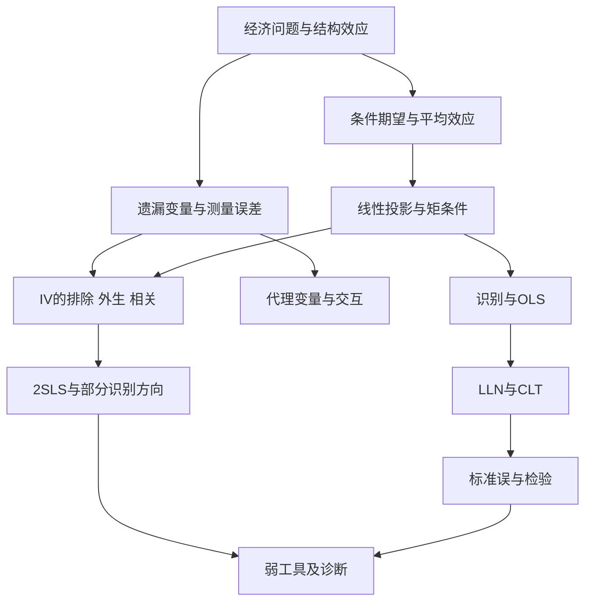

# 课程总目与知识体系

## 一、主问题：可见分布如何回答不可见的结构问题

计量经济学的困难不在于求出$(X'X)^{-1}X'y$，而在于说明它收敛到什么，以及那个对象是否回答原经济问题。把整门期中课程分成四个逻辑环节：**定义目标 → 给出识别限制 → 建立样本估计及分布 → 检查限制的脆弱性**。

条件期望把可观测分布转成可预测部分；投影把预测限制到线性空间；遗漏变量与测量误差说明预测系数何以偏离结构参数；代理变量与IV分别通过补充信息和更换正交方向恢复结构解释。最后，弱工具与诊断检验讨论这种恢复有多可靠。

## 二、重构章节与详细编纂方案

| 章 | 先修与原典 | 核心问题和数学结构 | 高观点与考试层次 |
|---|---|---|---|
| 1 条件期望、效应与信息 | L1 pp.18–49；L2全篇；条件概率、微积分 | CE、LIE、方差分解、PE/APE、弹性、均值对数差异 | 信息集合与投影；A：LIE、效应计算、PS1 Q1/Q3 |
| 2 线性投影、识别与OLS | 第1章；L3a pp.6–116、166–277 | 正交条件、满秩、FWL、样本恒等式、一致与无偏 | 正交投影与逆问题；A：OLS.1–3区别、证明 |
| 3 渐近推断与检验 | 第2章；L3a pp.108–136、144–156、279–341；L3b pp.7–30、81–110 | 渐近线性化、夹心协方差、Wald、F、LM、Delta | Mahalanobis距离；A：t/F/稳健推断；B：LM细节 |
| 4 遗漏变量、代理与随机系数 | 第1、2章；L3b pp.33–57、113–139；L2 pp.118–128、188–199 | OVB、冗余和充分性、交互、中心化 | 投影充分性与条件均值充分性；A：PS1 Q2/Q3/Q4 |
| 5 测量误差及其修复 | 第2、4章；L3b pp.59–74、141–150；L4b pp.44–54、77–79、132–138、144 | 衰减因子、残差化信号、重复测量IV | 信息不足与可识别性；A：推导和方向辨析 |
| 6 IV与2SLS | 第2、3章；L4a全篇；L4b pp.4–34、80–119、131 | IV比率、简约式、ITT、条件相关、秩、2SLS、结构残差 | 斜投影与矩条件；A：解释与应用；B/C：完整一致性证明 |
| 7 弱工具、诊断与稳健推断 | 第3、6章；L4b pp.35–42、56–71、120–130、139–152 | 第一阶段F、内生性检验、过度识别、稳健IV、加权 | 识别强度与统计不稳定；A：检验用途及局限；C：研究应用 |

章节已经按此方案成文，非待办占位。每章题型给出解法；PS1单列详解避免正文被作业顺序割裂。

## 三、三条跨章脉络

**正交脉络**：$E(u\mid x)=0\Rightarrow E[h(x)u]=0$，OLS只选有限个$h$，IV则选与结构误差正交的其他方向。条件均值、投影、矩估计不是三套无关技巧。

**目标脉络**：结构效应$\partial m(x,q)/\partial x$与可见CE斜率不同；总体APE、样本APE、局部参考点斜率不同；有效IV在异质性下不自动识别总体ATE。

**不确定性脉络**：$N^{-1/2}$控制抽样噪声，矩阵逆控制噪声放大。增加样本能缩小随机误差，却不能消除非零矩偏差；稳健协方差能处理方差异质，却不能修复错误的识别限制。

## 四、期中复习路径

已有Hansen基础者，第一遍从第2章的假设表、第4章的代理条件、第5章的多元衰减、第6章的2SLS与残差、第7章的三个诊断开始。随后做PS1，不看解答独立重写Q1–Q3，并手算Q4的单位解释、联合检验和中心化变换。第二遍用第1、3章补齐效应与推断的严格条件。

考前使用 `exam/` 五份短文；`higher_views/` 在关键推导卡住时使用，不作为额外背诵负担。允许的A4资料纸可从公式表删选，但本项目Markdown没有进行实际双面A4排版，不能声称已经满足物理页数。

## 五、缺件后的继续起点

收到PS2后，先逐题映射第5–7章，标记新题型，再补题解及更新索引；收到Midterm Review后，按教师明确的排除或强调修订优先级；收到IV Supplement后，核对目前标为编者补注的矩阵证明。后续L5以外内容另建第二阶段，不覆盖已有章节。
