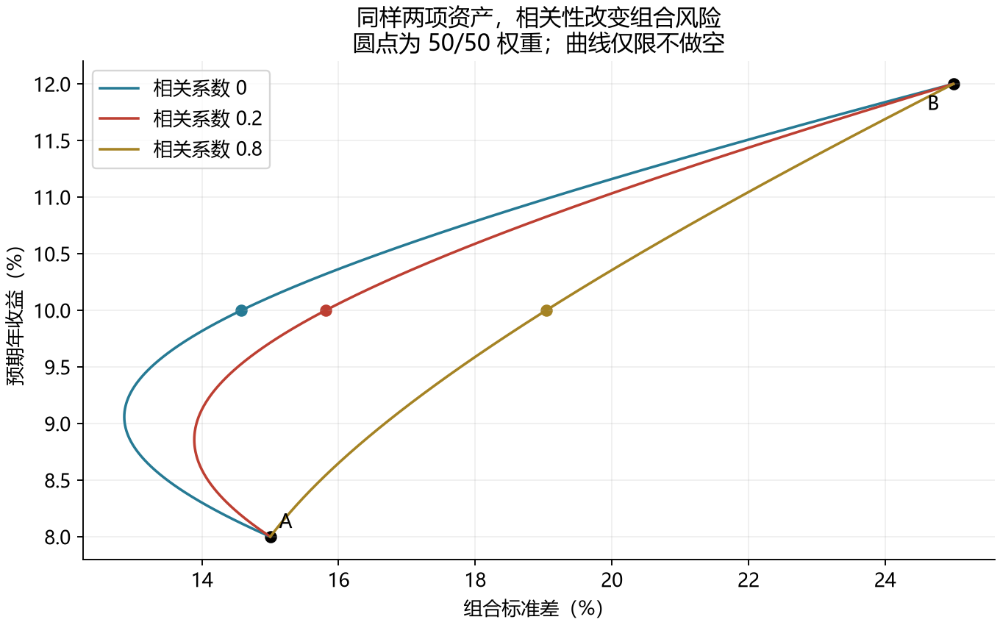
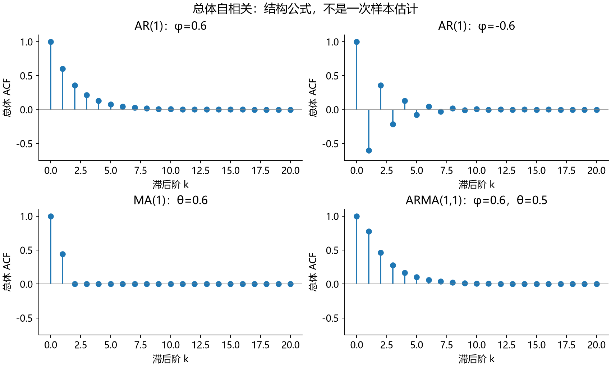
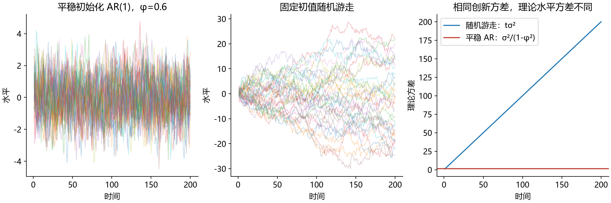
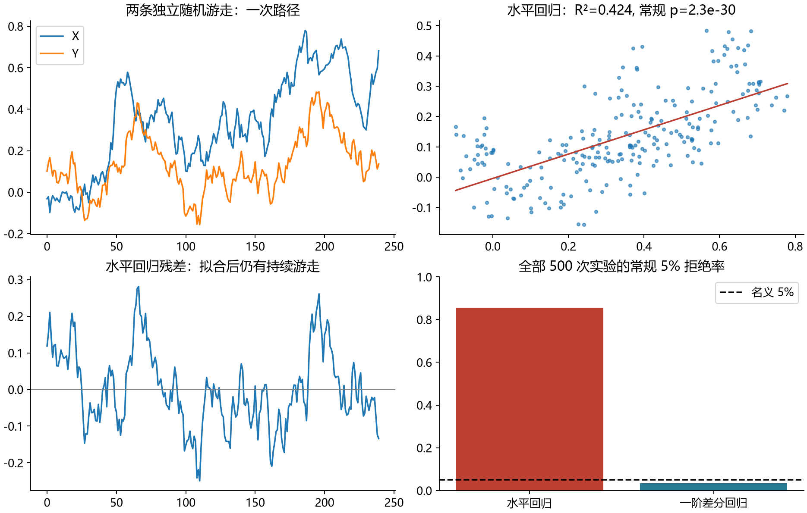

# ECO6109 金融市场计量详细注疏

适合有数学与计量理论基础、未系统学习金融计量的读者。依据前五份课件重构为七章；最后一份机器学习暂缓。

以问题动机、概念解释、逐步推导、算例、条件与辨析为主。完整来源与处理记录见同目录《课件覆盖索引》。

## 目录
- [第1章 金融市场、收益与信息：先弄清楚我们在测量什么](#ch01)
- [第2章 风险、分散化与投资组合：为什么风险不是收益的加权平均](#ch02)
- [第3章 从历史收益到统计推断：平均赚钱，证据有多强](#ch03)
- [第4章 市场回归、CAPM 与投资表现：β 和 α 为什么不同](#ch04)
- [第5章 多因子、组合排序与截面回归：把股票特征变成可检验关系](#ch05)
- [第6章 平稳过程、ARMA 与预测：历史怎样影响未来](#ch06)
- [第7章 单位根、伪回归与协整：两条趋势为什么会制造显著性](#ch07)

高观点专题可在初读时跳过。
- [高观点专题1：收益预测、回归与风险调整为何都涉及投影](#view01)
- [高观点专题2：ARMA、单位根与协整是冲击传递结构的不同情形](#view02)

---

## 第1章 金融市场、收益与信息：先弄清楚我们在测量什么

> 来源：LI pp.13–31；LII pp.2–28。金融术语与收益定义为【原课件】；财富推导、数值例子及信息集说明为【编者补注】。

### 章旨：会回归之前，先知道回归的对象

如果告诉你“某只股票价格从 10 元涨到 20 元”，你可能认为它表现很好。但如果这用了二十年，或中间有配股、拆股、分红，仅看两个价格就不能判断投资结果。相反，一只股票价格下跌，也可能由于发放现金股息而仍有正的总收益。

本章要建立此后所有统计工作的共同语言：我们交易的是未来现金流的权利，观察的是价格，真正比较的往往是投入资金的收益率。金融计量研究的不是一个统一的“涨跌问题”，而是不同的测量、预测和解释问题。

### 一、金融市场为什么存在

#### 1. 从储蓄者到融资者

设一个人暂时有 10 万元不用，一家公司需要 10 万元购买设备。前者希望把现在的购买力带到未来，后者希望提前使用未来收入。金融合约把这两种需求连接起来。

**债券（bond）**主要约定本金、利息与偿付次序；**股票（stock）**代表企业的所有权份额，其持有人通常享有剩余现金流的权益，而不是固定利息承诺。**银行存款**是对银行的债权。**衍生品（derivative）**的支付依赖另一项价格或事件，例如期权给持有人按约定条件买卖标的资产的权利。这些都是金融资产，设备与厂房则是实物资产。

课件强调金融市场的三项作用。第一是**消费平滑**：收入高时储蓄，收入低时使用储蓄或借款。第二是**风险分担**：把某一种不利事件的损失分摊给愿意承担它的人。第三是**资源配置**：让融资条件反映项目的预期现金流和风险。这三种作用都依赖信息与激励；资金很多，并不保证投资去了生产率最高的地方。

#### 2. 一级市场与二级市场

在**一级市场（primary market）**，企业发行新证券，融资进入企业。在**二级市场（secondary market）**，投资者转让已有证券，买款通常进入卖方投资者账户。你买入一股别人持有的股票，不能直接说“这笔钱交给了该公司”。

二级市场仍然影响融资：如果未来容易出售，投资者可能更愿意参与新发行；交易价格也提供估值信号。这涉及**流动性（liquidity）**，即资产能否迅速交易且不造成很大的价格变化。流动性好，不等于价格不会跌；它主要描述交易的难易和价格冲击。

货币市场通常交易一年内的短期债务，债券市场交易较长期债务，股票、外汇、商品和衍生品市场则按交易对象分类。**交易所是交易场所和制度，指数是描述一组资产表现的统计量，ETF 是可交易的基金。** 三者不能混用：S&P 500 是指数，SPY 是跟踪它的 ETF，某个交易所则不是指数。

#### 3. 为什么需要关注代理问题和道德风险

股东拥有企业，但日常决策由经理执行，目标可能不一致，这叫**委托—代理问题**。经理若只按短期利润领取奖金，就可能选择短期收益高、长期尾部损失大的项目。

**道德风险（moral hazard）**强调行为者承担的后果不完整：收益归自己，部分损失由别人承担，于是风险选择发生改变。这里“风险高”不只是统计方差大，而是收益与责任的分配改变了行为。金融计量可以测量结果，却不能仅从一个显著相关系数证明这种激励机制。

#### 4. 价格为什么会变：现金流与贴现

【编者补注】为了把“价格反映预期”讲具体，考虑一张一年后确定支付 105 元的合约，假设没有违约与交易摩擦，同期限折现率为 $y$。其价格满足

$$
P=\frac{105}{1+y}.
$$

$y=5\%$ 时价格为 100；若贴现率升到 $10\%$，同样现金流的价格降为约 95.45。这说明价格变化既可来自未来支付预期改变，也可来自投资者要求的贴现率改变。对不确定股票现金流，风险调整更复杂，不能只用一个任意固定利率当作完整定价理论。

因此，良好财报公布后股价仍可能下跌：实际消息可能低于原先已进入价格的预期，或者贴现率上升。统计分析要研究“超出原预期的信息”时，不能把消息的绝对好坏与价格变化简单对应。

#### 5. 指数与 GDP 为什么可以表现不同

课件 LII pp.8–9 比较交易所和股票指数。指数把一组股票按规则汇总，按市值加权、按价格加权与等权会赋予股票不同影响；指数点位还含人为基期与除数。两个指数一个为 4000 点、一个为 20000 点，不能据此说后者贵五倍，也不应在未统一币种时比较市场规模。

pp.21–22 把股指和 GDP 增长并列，目的在于提出解释问题。GDP 衡量一段时期的产出流量，股票价格反映上市企业未来股东现金流的现值；企业覆盖范围、跨国收入、利润与劳动报酬分配、发行回购、估值和贴现率都可能不同。即使经济产出上升，股票也不保证按同比例上涨。图上并行或背离都不能单独识别因果机制。

这些历史表格中的规模、排名和成分数按课件时点理解；本文不把它们作为最新市场数字。学习重点是指数的定义和比较口径。

### 二、从财富变化推导收益率

#### 1. 简单收益、总收益倍数与股息

期初花 $P_{t-1}$ 买一股，期末股票值 $P_t$，持有期间收到股息 $D_t$。暂不考虑税、费用、拆股及期间现金流的再投资时点问题，期末总价值为 $P_t+D_t$。因此每投入一元得到的期末价值是

$$
G_t=\frac{P_t+D_t}{P_{t-1}}.
$$

扣除最初的一元本金，得到**简单净收益率（simple net return）**

$$
R_t=G_t-1=\frac{P_t-P_{t-1}+D_t}{P_{t-1}}.
$$

总收益倍数 $1.05$ 与净收益率 $0.05$ 描述同一件事。不能把 $1.05$ 当作 $105\%$ 的净盈利。

**例：价格下跌但投资赚钱。** 期初 100 元，期末 98 元，股息 5 元，则

$$
R_t=\frac{98-100+5}{100}=0.03=3\%.
$$

价格收益是 $-2\%$，总收益是 $3\%$。做投资表现比较时，需要说明是否包括股息。

#### 2. 为什么不同股票不能直接比较价格差

A 从 10 涨到 11，B 从 100 涨到 105。前者每股多 1 元，后者多 5 元，但相同资金投入下，A 的收益为 $10\%$，B 为 $5\%$。收益率消除了投入规模的影响。

若一拆二后股价从 100 变为 50，持有数量同时翻倍，投资者财富没有因此减半。直接对未经调整的每股价格求比值，就会制造一个假的 $-50\%$ 收益。**复权价格（adjusted price）**是为使价格比值在特定规则下反映拆股、分红等事件而构造的序列；实际使用前应核对数据源的调整方法。若调整价格已经含分红，不要再加一次 $D_t$。

#### 3. 多期收益为什么要连乘

如果每期收益都继续投入，财富遵循

$$
V_t=V_{t-1}(1+R_t).
$$

连续代入：

$$
V_T=V_0\prod_{t=1}^T(1+R_t),\qquad
R_{1:T}=\prod_{t=1}^T(1+R_t)-1.
$$

第一期上涨 $20\%$，第二期下跌 $20\%$，100 元依次变成 120 元与 96 元。算术平均为零，但累计收益为

$$
1.2\times0.8-1=-4\%.
$$

关键是第二期的 $20\%$ 损失作用于 120 元，损失 24 元；它不是第一期 20 元盈利的反向操作。

**几何平均收益率**定义为一个固定的每期收益，使它在 $T$ 期后产生相同财富：

$$
(1+R_g)^T=\prod_{t=1}^T(1+R_t)
\quad\Longrightarrow\quad
R_g=\left[\prod_{t=1}^T(1+R_t)\right]^{1/T}-1.
$$

上例每月几何平均约为 $\sqrt{0.96}-1=-2.0204\%$。算术平均描述单期收益的样本平均，几何平均描述实际复利增长，两者回答不同问题。

### 三、为什么金融计量常用对数收益

#### 1. 对数把财富乘法变成加法

当 $G_t>0$ 时，定义**对数收益（log return）**

$$
r_t=\log G_t=\log(1+R_t).
$$

多期累计对数收益为

$$
\log\frac{V_T}{V_0}
=\log\prod_{t=1}^TG_t
=\sum_{t=1}^Tr_t.
$$

所以对数收益可以跨期直接相加，再用 $R_{1:T}=\exp(\sum r_t)-1$ 还原简单累计收益。股息存在时，这一财富等式对应总收益逐期再投资的约定；不能不加说明地将它等同于原始股价首尾比。

#### 2. 近似的来源和失效情形

在零附近作 Taylor 展开：

$$
\log(1+R)=R-\frac{R^2}{2}+\frac{R^3}{3}-\cdots.
$$

当 $R$ 很小时，二阶及以后各项较小，所以 $r\approx R$。$R=1\%$ 时，$\log1.01\approx0.9950\%$；$R=20\%$ 时，$\log1.2\approx18.2322\%$，二者已不能随意互换。$R=-100\%$ 时财富归零，对数收益没有有限值；简单收益本身仍可定义。

由对数的凹性，

$$
E[\log(1+R)]\leq\log(1+E[R]).
$$

这解释了为什么“平均单期收益不错”并不等于长期增长同样好。更具体地，在收益较小且二阶近似适用时，

$$
E[r]\approx E[R]-\frac12E[R^2]
=\mu_R-\frac12(\sigma_R^2+\mu_R^2).
$$

常见的 $\mu_R-\sigma_R^2/2$ 还进一步忽略了 $\mu_R^2$。它是近似，不是所有分布下的精确恒等式。

#### 3. 时间可加与资产可加要分开

期初把比例 $w_i$ 分配到第 $i$ 个资产，$\sum_iw_i=1$，则一时期末财富为

$$
V_t=\sum_iV_{t-1}w_i(1+R_{i,t})
=V_{t-1}\left(1+\sum_iw_iR_{i,t}\right).
$$

所以

$$
R_{p,t}=\sum_iw_iR_{i,t}.
$$

这是简单收益对资产的可加性。组合对数收益则是

$$
r_{p,t}=\log\left(1+\sum_iw_iR_{i,t}\right),
$$

一般不等于 $\sum_iw_ir_{i,t}$。记忆时应把两条规则配对：**简单收益跨资产按期初权重加权；对数收益跨时间相加。**

### 四、基准、无风险收益和超额收益

#### 1. 为什么要扣除无风险收益

假设同一月份，某投资赚 $1\%$，而无需承担该投资风险的基准赚 $0.3\%$。相对于这种资金机会成本，投资多赚了 $0.7$ 个百分点：

$$
R_t^e=R_t-R_{f,t}.
$$

这叫相对于无风险基准的**超额收益（excess return）**。相对于市场指数的差额 $R_p-R_M$ 也可称相对基准收益，但不能与无风险超额收益混为一谈。第4章将解释：跑赢指数并不必然具有正 α。

如果无风险收益在该持有期开始时已知，则条件上可把它视为常数。在整个历史样本中它可能随月份变化，此时

$$
\operatorname{Var}(R_p-R_f)
=\operatorname{Var}(R_p)+\operatorname{Var}(R_f)
-2\operatorname{Cov}(R_p,R_f),
$$

不应机械等同于 $\operatorname{Var}(R_p)$。

#### 2. 月度收益不能直接减年化收益率

图表中“按月观测的十年期国债年化收益率”有三个信息：观测间隔为月、债券期限为十年、收益率按年表示。它不等于“一个月持有国债的实际收益”。

若 $y$ 是有效年收益率，且按同一固定复利机制折算，月收益为 $(1+y)^{1/12}-1$。若 $y$ 来自其他报价方式，须遵循其报价 convention；直接除以 12 只是特定约定或小利率近似。长期债券提前卖出还承受价格波动，不能因为发行人为政府就将一个月持有收益视为确定。

### 五、数据结构决定问题和方法

同一天的许多股票构成**截面数据**，同一股票逐月的收益构成**时间序列**，许多股票在许多月份的收益构成**面板数据**。用 $R_{i,t}$ 记收益，就能看清自己固定了哪一个下标。

**同期解释**可以研究 $R_{\mathrm{AAPL},t}$ 与 $R_{M,t}$ 的关系；**事前预测**则必须在 $t-1$ 时拿到所用变量。例如

$$
R_{\mathrm{AAPL},t}=a+bR_{M,t-1}+u_t
$$

才是用上月市场收益预测本月苹果收益的形式。把本月已经实现的市场收益代入同期回归，得到的是条件于该市场结果的拟合值；在上月末还无法直接使用它作无条件预测。

计算 2020 年 1 月月收益，需要 2019 年 12 月末与 2020 年 1 月末两个价格。这就是 LI pp.27–29 为什么要求从 2019 年 12 月开始下载。日数据转月数据时，应取每月最后交易日的价格，再求相邻月末比值；月末日历日期没有交易时，不能凭空填造一个成交价。

样本比较还要对齐币种、日期、分红处理、缺失值和单位。一个序列用 5 表示 $5\%$，另一个用 0.05 表示 $5\%$，未经转换的回归会产生百倍的单位错误。

### 六、有效市场究竟说了什么

#### 1. “信息已进入价格”并非“价格不动”

**有效市场假说（efficient markets hypothesis, EMH）**讨论价格对给定信息集合的反映。若一条利好人人已知，交易压力可能已把价格推高；仅仅复述该利好，未必还能买到便宜资产。新消息仍然会使价格变化。

弱式效率针对历史价格和交易信息；半强式效率针对全部公开信息；强式效率进一步包括私人信息。信息集逐层包含，所以强式蕴含半强式，半强式蕴含弱式。相应的异常利润必须相对于适当风险基准，并考虑交易及信息成本。

#### 2. 为什么可预测收益不自动推翻效率

假设某些月份系统风险更高，投资者要求更高的预期收益。若公开变量识别了这些月份，条件预期收益可以随信息变化：

$$
E[R_{t+1}\mid\mathcal I_t]=\mu_t.
$$

$\mu_t$ 可预测并不说明剩余收益是无风险的，也不说明投资者获得了超出风险补偿的异常利润。经验研究通常同时检验信息处理与风险调整模型；模型遗漏风险，也可能留下所谓 α。这是后面解释回归截距必须谨慎的原因。

**随机游走是某一类具体价格模型，EMH 是更一般的信息与定价命题。** 不能把某个 AR 系数为零的检验当作整套效率假说的充分检验。

#### 3. 技术分析、基本面分析与两项批评

技术分析使用历史价格及交易模式，基本面分析使用财报和经济信息。其评价应围绕风险调整后的样本外净表现，而不是历史图形是否“看起来有规律”。

课件 LII p.26 提到两项批评。信息获取有成本时，价格若完全免费揭示所有信息，花钱搜集信息的激励可能消失；这限制了“完全揭示”的均衡设想。套利还面临融资约束和中途损失：即使最终判断正确，也可能在价格纠正前被迫平仓。本文仅转述课件的机制，不假装已逐篇核验其历史论证。

### 七、评注与高观点：信息集是贯穿全书的时间坐标

【高观点拓展】把 $\mathcal I_t$ 视为截至 $t$ 的可观测事件集合，通常要求 $\mathcal I_t\subseteq\mathcal I_{t+1}$。可执行的投资权重 $w_{i,t}$ 必须由 $\mathcal I_t$ 决定；不能用 $R_{i,t+1}$ 再决定自己“昨天持有什么”。这是一条数学上的可测性要求，也是避免回测偷看未来的经济要求。

后面出现的条件均值、创新、预测和配对交易都服从同一时间原则：先确定信息何时可得，再决定统计对象。知道一家公司的年报对应哪一年，仍不够；预测时还要知道年报何时公开。

### 八、练习与逐步解答

#### 题1【课件练习改写，LII p.17】

两月收益依次为 $20\%,-20\%$，计算算术平均、累计收益及总对数收益。

**解：** 算术平均为零。100 元变成 $100(1.2)(0.8)=96$ 元，累计收益 $-4\%$。对数收益相加为 $\log1.2+\log0.8=\log0.96\approx-0.040822$，即约 $-4.0822\%$ 的累计对数收益。将它指数化后才得到简单收益 $-4\%$。

#### 题2【编者拟题】

期初股票 A、B 各投入 50 元，A 上涨 $20\%$，B 不变。组合收益多少？若不交易，下期期初 A 权重多少？

**解：** 期末 A 值 60，B 值 50，组合 110，收益 $10\%$。新权重为 $60/110=6/11\approx54.55\%$。因此“最初等权买入后一直持有”与“每月恢复等权”是两种策略；后者需要再平衡及可能的交易成本。

#### 题3【编者拟题】

用当月 SPY 收益解释当月 AAPL 收益，样本 $R^2$ 很高，能否说已找到上月末可实施的预测策略？

**解：** 不能。首先解释变量是同期实现值；上月末尚未知。其次样本内 $R^2$ 没有比较未来测试期误差，更没有扣除风险与费用。应先改成预测时已知的变量，再以简单预测为基准作样本外评估。

### 九、本章检查清单

你应能从财富方程推导单期、多期和组合收益；解释为何股息、拆股和再平衡会改变计算；区分收益、超额收益和风险调整表现；说明信息集与三种效率假说；识别一个预测是否使用了未来信息。后续第2章把收益视为随机变量，第4章才进一步引入 CAPM 的风险基准。

---

## 第2章 风险、分散化与投资组合：为什么风险不是收益的加权平均

> 来源：LIII pp.3–21，尤其 pp.11–19。概率概念与组合公式为【原课件】；最小方差权重、完整数值计算与条件风险的分解为【编者补注】。

### 章旨

如果两项投资各有 $20\%$ 波动，把它们各买一半，组合波动是不是仍为 $20\%$？答案取决于它们如何一起变动。若两者总是同涨同跌，组合很难消除波动；若一个受损时另一个常常上涨，组合就可能更稳定。

本章从随机变量的分布讲到组合二次型，目的不是复习所有概率论，而是把已有数学知识翻译成金融问题：什么是未知收益，什么是风险，哪些风险能够互相抵消，均值与方差还漏掉了什么。

### 一、收益是随机变量，历史收益是一次实现

#### 1. 分布回答“可能发生什么”

下月收益 $R$ 尚未实现，可以用随机变量描述。已经观测到的 $R=0.03$ 是它的一次实现，不是整条分布。违约指标 $D$ 只能取 0 与 1，可用 Bernoulli 分布描述：

$$
P(D=1)=p,\qquad P(D=0)=1-p.
$$

连续收益的累积分布函数为

$$
F_R(x)=P(R\le x).
$$

因此 $F_R(-0.05)$ 不是“亏损的期望”，而是收益不超过 $-5\%$ 的概率。如果分布有密度 $f_R$，则

$$
P(a<R\le b)=\int_a^bf_R(x)\,dx.
$$

密度是单位长度上的概率质量，不是单点概率。密度可以大于 1；连续分布中 $P(R=x)=0$，不妨碍区间概率为正。

正态模型 $R\sim N(\mu,\sigma^2)$ 可以用

$$
Z=\frac{R-\mu}{\sigma}
$$

标准化后查询概率。但实际简单收益有 $-100\%$ 下界，而正态分布没有，因此它通常只是某些区间上的近似；尾部评估尤其不能只因计算方便而默认正态。

#### 2. 预期收益不是承诺收益

课件 LIII p.7 给出三种状态：

| 状态 | 概率 | 收益 |
|---|---:|---:|
| 弱市场 | 0.20 | $-10\%$ |
| 普通市场 | 0.50 | $4\%$ |
| 强市场 | 0.30 | $12\%$ |

于是

$$
\mu=E[R]=0.2(-0.10)+0.5(0.04)+0.3(0.12)=0.036.
$$

预期收益是 $3.6\%$。它甚至不等于三种可能收益中的任何一个，也不保证实际能赚到 $3.6\%$。

### 二、方差为什么能够衡量风险，又为什么不够

#### 1. 从离均差到波动率

方差与标准差为

$$
\sigma^2=E[(R-\mu)^2],\qquad \sigma=\sqrt{\sigma^2}.
$$

对上面的三状态例子：

$$
\begin{aligned}
\sigma^2
&=0.2(-0.10-0.036)^2
+0.5(0.04-0.036)^2
+0.3(0.12-0.036)^2\\
&=0.0036992+0.000008+0.0021168\\
&=0.005824,
\end{aligned}
$$

所以 $\sigma\approx0.076315$，即 $7.6315\%$。均值用百分比表示时，方差对应平方单位；标准差与收益有相同单位，因而更便于交流。

金融中常把标准差称为**波动率（volatility）**。它同时处罚高于均值与低于均值的偏离，所以风险厌恶者关心的“严重亏损”未必由方差完整刻画。流动性不足、被迫平仓、模型失效，也不是单一波动率能描述的。

#### 2. 加杠杆为什么让标准差线性、方差平方增长

若收益 $R$ 乘以常数 $b$ 并加确定项 $a$，

$$
E[a+bR]=a+bE[R],\qquad
\operatorname{Var}(a+bR)=b^2\operatorname{Var}(R).
$$

确定性现金流改变均值但不改变方差；风险敞口放大两倍，标准差放大两倍，方差放大四倍。这也是资产权重在组合方差公式中以平方出现的原因。

### 三、协方差：两项风险能否互相抵消

#### 1. 定义的金融翻译

$$
\operatorname{Cov}(R_A,R_B)
=E[(R_A-\mu_A)(R_B-\mu_B)].
$$

当两者经常同时高于或同时低于各自均值，乘积常为正，协方差倾向于正。相关系数将其标准化：

$$
\rho_{AB}=\frac{\operatorname{Cov}(R_A,R_B)}{\sigma_A\sigma_B},
\qquad -1\le\rho_{AB}\le1,
$$

要求两项标准差均为正。协方差受单位影响，相关系数不受正的尺度变换影响。

协方差为正，不意味着每个月都同涨同跌。这里比较的是相对于各自均值的偏离，而不是简单比较是否大于零。

#### 2. 为什么零相关仍可能完全可预测

令 $X\sim U[-1,1]$，$Y=X^2$。对称性给出 $E[X]=E[X^3]=0$，所以

$$
\operatorname{Cov}(X,Y)=E[X^3]-E[X]E[X^2]=0.
$$

但只要知道 $X$，就精确知道 $Y$。零相关排除了线性共变，并没有排除非线性依赖。课件 LIII p.10 的弯曲散点图正是在提示这种区别。

独立在有限二阶矩下推出不相关；反向一般不成立。只有加上联合高斯等特殊结构时，零相关才能推出独立。分别正态的边际分布也还不够，关键是联合分布。

### 四、两资产组合方差的完整推导

期初以固定权重 $w$ 投资 A，以 $1-w$ 投资 B，本节先限制 $0\le w\le1$。由第1章：

$$
R_p=wR_A+(1-w)R_B.
$$

取期望即得

$$
\mu_p=w\mu_A+(1-w)\mu_B.
$$

现在把均值减掉：

$$
R_p-\mu_p=w(R_A-\mu_A)+(1-w)(R_B-\mu_B).
$$

平方时必须保留交叉项：

$$
\begin{aligned}
(R_p-\mu_p)^2
={}&w^2(R_A-\mu_A)^2+(1-w)^2(R_B-\mu_B)^2\\
&+2w(1-w)(R_A-\mu_A)(R_B-\mu_B).
\end{aligned}
$$

再取期望：

$$
\boxed{\sigma_p^2=w^2\sigma_A^2+(1-w)^2\sigma_B^2
+2w(1-w)\rho_{AB}\sigma_A\sigma_B.}
$$

这一步说明，**收益的均值只需资产各自的均值，组合风险还需它们的共同变动方式**。

#### 1. 三种相关结构的比较

当 $\rho=1$，

$$
\sigma_p=w\sigma_A+(1-w)\sigma_B.
$$

风险恰好不能因相关结构而打折。当 $\rho<1$ 且 $0<w<1$、两项标准差为正时，

$$
\sigma_p<w\sigma_A+(1-w)\sigma_B.
$$

注意，这不保证组合比每一个单独资产都安全，只保证比标准差的加权平均小。

当 $\rho=-1$，

$$
\sigma_p=|w\sigma_A-(1-w)\sigma_B|.
$$

令 $w=\sigma_B/(\sigma_A+\sigma_B)$ 可使两项风险完全抵消。它依赖完美负相关，不是现实组合中普遍可达到的无风险构造。

#### 2. 课件数值例的独立计算

LIII p.13：$\mu_A=8\%,\mu_B=12\%,\sigma_A=15\%,\sigma_B=25\%$。各持一半，均值始终为 $10\%$。

当 $\rho=0.2$，

$$
\sigma_p^2=0.25(0.15)^2+0.25(0.25)^2
+2(0.5)(0.5)(0.2)(0.15)(0.25)=0.025,
$$

因此 $\sigma_p=15.8114\%$。其余结果为：

| 相关系数 | 50/50 方差 | 50/50 标准差 |
|---:|---:|---:|
| 0 | 0.02125 | $14.5774\%$ |
| 0.2 | 0.02500 | $15.8114\%$ |
| 0.8 | 0.03625 | $19.0394\%$ |

固定权重时，相关性不进入均值公式，却进入风险公式，所以预期收益不变而标准差变化。这不是“低相关提高了每项资产收益”，而是它改变了组合。

图由上述课件假设参数计算。横轴是风险、纵轴是均值，三个圆点均为 50/50。曲线从 A 到 B 的部分包含被其他组合支配的低收益支段，不能把整条可行曲线都叫作有效边界。

#### 3. 如何求最小方差权重【编者补注】

令 $c=\operatorname{Cov}(R_A,R_B)$，把方差展开：

$$
v(w)=w^2(\sigma_A^2+\sigma_B^2-2c)
+w(-2\sigma_B^2+2c)+\sigma_B^2.
$$

若 $d=\sigma_A^2+\sigma_B^2-2c=\operatorname{Var}(R_A-R_B)>0$，

$$
v'(w)=2wd-2(\sigma_B^2-c).
$$

令导数为零：

$$
w_A^*=\frac{\sigma_B^2-c}{\sigma_A^2+\sigma_B^2-2c}.
$$

因 $v''(w)=2d>0$，这是无约束最小点。禁止做空时，应将其截到 $[0,1]$ 内。若 $d=0$，两个收益只差一个常数，不能继续除以 $d$，须直接检查退化情形。

上例 $\rho=0.2$ 时，$c=0.0075$，$w_A^*=0.055/0.07=11/14\approx78.57\%$，预期收益约 $8.8571\%$，方差为 $0.0192857143$，标准差约 $13.8873\%$。最小方差不是最高收益，更不等于所有人的最佳选择。

### 五、多资产、有效组合与分散化的边界

记 $R=(R_1,\ldots,R_N)'$，均值向量 $\mu$，协方差矩阵 $\Sigma$。对确定权重 $w$：

$$
E[R_p]=w'\mu,\qquad \operatorname{Var}(R_p)=w'\Sigma w.
$$

$\Sigma$ 半正定，因为任意向量 $a$ 都有 $a'\Sigma a=\operatorname{Var}(a'R)\ge0$。给定目标收益 $m$ 的最小方差组合可写为

$$
\min_w w'\Sigma w
\quad\text{s.t.}\quad w'\mu=m,\quad w'\mathbf1=1,
$$

另可加 $w_i\ge0$ 等限制。处于可行集上方边界、不能在同样风险下提高收益的组合构成均值—方差有效边界。有效只表示在指定指标与限制内不被支配，不表示收益有保证。

若 $R_i=\mu_i+bF+u_i$，共同因子 $F$ 与特有风险 $u_i$ 不相关，且 $u_i$ 彼此不相关、方差均为 $\sigma_u^2$，等权组合的风险为

$$
\operatorname{Var}(R_p)=b^2\operatorname{Var}(F)+\frac{\sigma_u^2}{N}.
$$

随着 $N$ 增大，后一项趋零，共同市场风险仍存在。这给“分散化消除特有风险而不能消除共同风险”一个明确条件下的证明。若特有项也显著相关或个别仓位过大，$1/N$ 的衰减未必适用。

### 六、Sharpe 比率衡量什么

对组合无风险超额收益 $R_p^e$：

$$
SR=\frac{E[R_p^e]}{\sqrt{\operatorname{Var}(R_p^e)}}.
$$

它比较每单位超额收益波动对应的预期超额收益。例如超额均值 $6\%$、标准差 $12\%$，则 Sharpe 为 0.5。若用的是单月统计量，它就是月度口径；不能直接与别人的年度比率比较。

若相同分布的超额收益跨期不相关，$H$ 期**加总收益**的均值为 $H\mu$、标准差为 $\sqrt H\sigma$，所以其比率为 $\sqrt H\,SR$。这是常用平方根年化的基础。对简单复利收益，这还涉及加总近似；若有自相关，则

$$
\operatorname{Var}\left(\sum_{t=1}^HR_t^e\right)
=H\gamma_0+2\sum_{k=1}^{H-1}(H-k)\gamma_k,
$$

不能只写 $H\sigma^2$。历史 Sharpe 还存在估计误差；不同样本期、无风险口径和费用处理都可能改变排序。

### 七、偏度、峰度与 VaR：均值方差之外

#### 1. 偏度与峰度的含义

在所需矩存在、$\sigma>0$ 时，

$$
\operatorname{Skew}(R)=E\left[\left(\frac{R-\mu}{\sigma}\right)^3\right],\qquad
\operatorname{Kurt}(R)=E\left[\left(\frac{R-\mu}{\sigma}\right)^4\right].
$$

三次方保留偏离方向，负偏度意味着分布在标准化三阶矩意义上向负侧倾斜。四次方给极端偏离很高权重。正态峰度为 3，**超额峰度**为峰度减 3。峰度不能被简单解释成“峰顶有多尖”，也不能独自确定某一个尾部概率。

一个策略可能常常小赚、偶尔大亏，因而历史均值和标准差看似不错，却有严重左尾风险。比较 Sharpe 时忽略这种形状差异，结论可能不完整。

#### 2. 分位数和损失方向

分位数的通用定义为

$$
q_\alpha(X)=\inf\{x:F_X(x)\ge\alpha\}.
$$

令一日美元损失 $L=-\Delta V$，则

$$
\operatorname{VaR}_{0.95}=q_{0.95}(L).
$$

95% VaR 为 180 万美元，表示在所用模型与期间下，损失大约有 95% 的概率不超过此阈值；连续模型下超越概率约 5%。它不是最大可能损失，也没有告诉你超越之后平均亏多少。离散分布中还需留意分位点的概率质量，不能保证超越概率恰为 5%。

若 $R\sim N(\mu,\sigma^2)$、组合初值 $V_0$、$L=-V_0R$，则

$$
\operatorname{VaR}_{0.95}(L)
=V_0(-\mu+z_{0.95}\sigma),\quad z_{0.95}\approx1.64485.
$$

这是模型内的计算结果；风险水平、期限、单位与分布假设必须一起报告。

### 八、条件风险：平均风险稳定，也可以时高时低

用 $X_t$ 表示时点 $t$ 已知信息，定义

$$
\mu(X_t)=E[R_{t+1}\mid X_t],\qquad
\sigma^2(X_t)=E[(R_{t+1}-\mu(X_t))^2\mid X_t].
$$

市场可能在安静期与动荡期都有相近的条件均值，却有很不同的条件方差。“难以预测平均收益”因此不等于“无法预测风险”。

迭代期望定律给出

$$
E[R]=E[E[R\mid X]].
$$

课件两状态例：状态 A 概率 0.75、条件均值 $1\%$；状态 B 概率 0.25、条件均值 $-1\%$。无条件均值为 $0.5\%$。

【编者补注】再令 $u=R-E[R\mid X]$。因为 $E[u\mid X]=0$，$u$ 与 $E[R\mid X]-E[R]$ 的交叉项期望为零，故

$$
\boxed{\operatorname{Var}(R)
=E[\operatorname{Var}(R\mid X)]
+\operatorname{Var}(E[R\mid X]).}
$$

前项是给定信息后剩余的不确定性，后项是不同信息状态下均值的差异。更多信息可能改善预测，却不会把未来所有随机性消掉。

### 九、高观点：组合选择是估计驱动的优化问题

二次规划看似只需输入 $\mu,\Sigma$，现实中它们都未知。用 $\hat\mu,\hat\Sigma$ 得到的最优权重，还是样本的函数。若两个资产预期收益只差很小，均值估计误差就可能改变最优方向；若 $\hat\Sigma$ 接近奇异，求逆可能放大微小误差。

因此，“数学上精确求解估计后的问题”不保证“经济上接近真实最优”。这是计量与优化的连接：先问输入是否可可靠估计，再评价输出权重。不能用漂亮的有效边界图替代估计不确定性。

### 十、练习与检查

**题1【编者拟题】** 两资产标准差均为 $20\%$，等权，相关系数为 0.5。组合波动多少？

解：$\sigma_p^2=0.25(0.04)+0.25(0.04)+0.5(0.5)(0.04)=0.03$，故 $\sigma_p=\sqrt{0.03}\approx17.3205\%$。不能直接平均两个标准差，也不能因为分散就除以 $\sqrt2$；后者还要求不相关。

**题2【编者拟题】** 组合价值 100 万元，一日收益按正态近似，$\mu=0,\sigma=1\%$，求 95% VaR。

解：$1{,}000{,}000\times1.64485\times0.01\approx16{,}449$ 元。必须注明一日、95%、货币单位、正态模型；它没有给出最坏损失。

**检查清单：** 能逐行展开组合方差，独立算出课件 50/50 例子；能说明零相关不等于独立；能解释有效组合不等于所有人都应该持有的组合；能区分波动率、标准误、Sharpe 与 VaR。下一章开始研究这些总体量如何从有限历史样本估计。

---

## 第3章 从历史收益到统计推断：平均赚钱，证据有多强

> 来源：LIII pp.22–32；HAC 的应用还见 LIV p.23。均值检验与区间为【原课件】；长期方差推导、配对比较解释和完整计算为【编者补注】。

### 章旨

某策略过去五年平均月收益为 $0.5\%$，能否据此说它的预期收益为正？你已经学过假设检验，但金融应用的第一步依然是确定参数：检验的是原收益、相对于无风险利率的超额收益，还是相对于市场的平均差额？这几个检验可能给出不同答案。

第二步是识别随机性来源。历史样本不是总体本身；即使总体均值固定，换一段同样长度的样本，平均收益也会变化。我们要测量这种估计不确定性，并检查金融时间依赖是否破坏了常用公式。

### 一、估计量、估计值和总体均值

设 $R_1,\ldots,R_T$ 是观测收益，希望估计

$$
\mu=E[R_t].
$$

**估计量**是从样本到答案的规则：

$$
\bar R=\frac1T\sum_{t=1}^TR_t.
$$

**估计值**是把实际数据代入后的数字，如 $0.005$。总体均值是模型中的未知量，而不是把历史平均换一个名字。

为什么用平均数？若要用一个常数 $m$ 预测所有观测，最小化

$$
Q_T(m)=\frac1T\sum_{t=1}^T(R_t-m)^2,
$$

其导数为

$$
Q_T'(m)=-\frac2T\sum_t(R_t-m)=-2(\bar R-m).
$$

令导数为零得 $m=\bar R$，二阶导数为 2，因此唯一最小。样本平均是最小平方误差下的最佳样本内常数；这尚未说明它估计总体均值有多准确。

### 二、i.i.d. 基准下，为什么标准误是 $s/\sqrt T$

#### 1. 精确方差从双重求和开始

假设收益独立同分布，$E[R_t]=\mu$，$\operatorname{Var}(R_t)=\sigma^2<\infty$。由期望线性性，

$$
E[\bar R]=\mu.
$$

由独立推出不同时点协方差为零：

$$
\begin{aligned}
\operatorname{Var}(\bar R)
&=\frac1{T^2}\operatorname{Var}\left(\sum_tR_t\right)\\
&=\frac1{T^2}\left(\sum_t\operatorname{Var}(R_t)
+2\sum_{s<t}\operatorname{Cov}(R_s,R_t)\right)\\
&=\frac{\sigma^2}{T}.
\end{aligned}
$$

所以估计量的真实标准差为 $\sigma/\sqrt T$。由于 $\sigma$ 未知，用样本标准差

$$
s=\sqrt{\frac1{T-1}\sum_t(R_t-\bar R)^2}
$$

代入，得到估计标准误

$$
\widehat{SE}(\bar R)=\frac{s}{\sqrt T}.
$$

#### 2. 波动率与标准误不是一回事

$s$ 描述单个月收益在样本中的波动；$s/\sqrt T$ 描述估计平均收益的精度。收集更多独立月份，能够更准确地估计 $\mu$，却不会自动使下一月市场变稳定。

要把标准误减半，需要把样本长度增为四倍；从 60 个月增加到 120 个月，只缩小到原来的 $1/\sqrt2$。而跨越更长时期又可能遇到结构变化，不能无条件假定每一段历史都来自同一分布。

#### 3. LLN 与 CLT 分别解决什么

大数定律给出 $\bar R\overset p\to\mu$，说明样本足够大时估计集中到目标。中心极限定理给出

$$
\sqrt T(\bar R-\mu)\overset d\longrightarrow N(0,\sigma^2).
$$

前者说明极限位置，后者说明估计误差的近似尺度与形状。CLT 不是说每个月的收益会变成正态，而是说标准化后的样本均值在适当条件下接近正态。极端厚尾、矩不存在或强依赖时，不能直接援引这套结论。

### 三、检验和区间要从一个明确问题出发

#### 1. 假设与统计量

要研究预期收益是否异于零，设

$$
H_0:\mu=0,\qquad H_1:\mu\ne0.
$$

更一般地检验 $\mu=\mu_0$：

$$
t=\frac{\bar R-\mu_0}{\widehat{SE}(\bar R)}.
$$

分子是样本估计偏离原假设的距离，分母是这种偏离本来就可能因抽样产生的尺度。$t$ 大，不仅可能因为收益高，也可能因为估计精度高。

在大样本正态近似适用时，双侧 5% 检验以 $|t|>1.96$ 拒绝。若数据是独立同分布的正态变量，未知方差被样本方差替代后有精确 $t_{T-1}$ 分布；有限样本应使用该分布分位数。若仅有渐近正态，一般不能宣称有限样本精确服从 Student t。

#### 2. p 值到底以什么为条件

双侧正态近似下，

$$
p=2[1-\Phi(|t_{\mathrm{obs}}|)].
$$

它问：**假定原假设和统计模型成立，看到这么极端或更极端统计量的概率有多大？** 它不是 $P(H_0\text{ 为真}\mid\text{数据})$。没有拒绝可能因为真实效应小，也可能因为样本太少、噪声太大；不能写成“证明没有收益”。

在预先设定且校准正确的检验中，5% 显著性控制原假设成立时的错误拒绝概率；先测试很多策略再只展示最显著者，已不是同一个单次检验设计。

#### 3. 置信区间的重复抽样解释

大样本 95% 区间为

$$
\left[\bar R-1.96\widehat{SE}(\bar R),\
\bar R+1.96\widehat{SE}(\bar R)\right].
$$

若反复抽取同样机制的样本并构造区间，约 95% 的区间覆盖固定的 $\mu$。已经得到的一个区间，不是在频率学派框架内给固定参数分配 95% 的后验概率。

区间比“显著/不显著”更能表达经济大小：它显示哪些正负效应仍与样本相容。与之匹配的双侧 5% 检验，恰好在 $\mu_0$ 落在区间外时拒绝。

### 四、把课件的 60 个月例子逐步算完

LIII p.29：$T=60,\bar R=0.5\%,s=4\%$。全部先换为小数：

$$
\bar R=0.005,\quad s=0.04.
$$

第一步，标准误：

$$
\widehat{SE}=\frac{0.04}{\sqrt{60}}\approx0.00516398,
$$

即 $0.516398$ 个百分点。

第二步，统计量：

$$
t=\frac{0.005}{0.00516398}\approx0.968246.
$$

第三步，正态近似双侧 $p\approx0.333$，大于 0.05，不拒绝零均值。

第四步，区间：

$$
0.005\pm1.96(0.00516398)
=[-0.0051214,\ 0.0151214].
$$

换成百分比即 $[-0.51214\%,1.51214\%]$。历史平均为正，但总体均值为负仍未被排除。正确表述是“样本不足以在该检验及假设下确定总体均值异于零”，不是“平均收益等于零”，也不是“策略没有任何经济价值”。

若问题实际是“是否超过无风险收益”，应重新对 $R_t-R_{f,t}$ 计算均值与标准差。不能只把分子减掉一个平均无风险收益，仍沿用原收益的标准误。

### 五、比较组合与市场，为什么要用同月差值

课件 LIII pp.30–31 定义每月恢复等权的组合：

$$
R_{p,t}=\frac{R_{\mathrm{AAPL},t}+R_{\mathrm{MSFT},t}
+R_{\mathrm{JPM},t}}3,
$$

并用相同月份 SPY 作基准，构造

$$
D_t=R_{p,t}-R_{\mathrm{SPY},t}.
$$

目标是 $\delta=E[D_t]$，检验 $H_0:\delta=0$。在 i.i.d. 月份近似下，

$$
\bar D=\frac1T\sum_tD_t,\qquad
\widehat{SE}(\bar D)=\frac{s_D}{\sqrt T}.
$$

为什么不能将两组均值当作独立样本？因为同一月份组合和市场共同受宏观冲击。差值方差是

$$
\operatorname{Var}(D_t)
=\operatorname{Var}(R_{p,t})+\operatorname{Var}(R_{M,t})
-2\operatorname{Cov}(R_{p,t},R_{M,t}).
$$

正的同期协方差可能使差值比两项单独收益稳定得多。配对比较保留了这一结构；把日期打乱或把两组当独立样本，改变了问题。

差值检验仍没有调整风险暴露。组合如果 β 大于 1，在市场平均上涨的时期可能平均跑赢，却没有正 α。第4章会推导这个关系。

### 六、时间相关为什么改变标准误

#### 1. 不跳步地推导有限样本方差

假设收益协方差平稳，$\gamma_k=\operatorname{Cov}(R_t,R_{t-k})$。双重求和中，相隔 $k$ 期的配对共有 $T-k$ 组，因此

$$
\boxed{
\operatorname{Var}(\bar R)
=\frac1T\left[
\gamma_0+2\sum_{k=1}^{T-1}\left(1-\frac{k}{T}\right)\gamma_k
\right].}
$$

若相关为正，很多月份的信息部分重复，平均数的方差可能比 $\gamma_0/T$ 大；负相关则可能减小它。这里不需要诉诸“样本少了一些”的比喻，协方差本身就给出精确修正。

若自协方差绝对可和且有合适的弱依赖 CLT，

$$
\Omega=\gamma_0+2\sum_{k=1}^{\infty}\gamma_k,\qquad
\sqrt T(\bar R-\mu)\overset d\longrightarrow N(0,\Omega).
$$

$\Omega$ 称**长期方差（long-run variance）**。它是平均数长期抽样波动的决定因素，不是单个月收益方差。

#### 2. HAC 是在估计什么

HAC 指 heteroskedasticity and autocorrelation consistent，即允许异方差与自相关的一致协方差估计。在均值问题中，可用截断、加权的样本自协方差估计长期方差：

$$
\hat\Omega=\hat\gamma_0+
2\sum_{k=1}^L\left(1-\frac{k}{L+1}\right)\hat\gamma_k,\qquad
\widehat{SE}_{HAC}(\bar R)=\sqrt{\hat\Omega/T}.
$$

上式展示 Bartlett 权重的常用形式；$L$ 是带宽，不是收益预测模型中的 AR 阶数。样本较短时带宽会影响结果，应报告选择。HAC 依赖适当矩和依赖条件，不能给任意时间序列提供万能保证。

换 HAC 标准误不会改变 $\bar R$；回归中也不会改变 OLS 点估计。它改变的是对估计不确定性的评估。单位根、参数突变、遗漏风险与未来信息泄漏，都不能靠换标准误自动解决。

#### 3. 一个可计算的相关例子

若总体收益为平稳 AR(1)，自相关 $\rho_k=\phi^k$，$|\phi|<1$，则

$$
\Omega=\gamma_0\left(1+2\sum_{k=1}^\infty\phi^k\right)
=\gamma_0\frac{1+\phi}{1-\phi}.
$$

$\phi=0.5$ 时，长期方差为单期方差的 3 倍，大样本均值标准误约是独立公式的 $\sqrt3$ 倍。把样本平均收益算准，和把它的标准误算准，是两件独立工作。

### 七、评注：频率更多，不等于信息同比增多

将五年月度数据改成日度数据，观测条数增加，但这不意味着对长期平均收益的精度机械提高 $\sqrt{21}$ 倍。日收益波动尺度随持有期变化，日内或跨日依赖也可能变化，样本覆盖的经济时期仍只有五年。

在一个简单的连续时间近似里，收益均值随时间长度成比例，噪声标准差随时间平方根变化，因此平均增长率的可估计精度主要受总跨度影响。这里的高观点不是否认高频数据价值，而是提醒：数据频率、独立信息和研究参数要同时考虑。

### 八、考试题型与详细解法

#### 题1【编者拟题：配对均值】

已对齐的 100 个月差值均值为 $0.4\%$，标准差 $2\%$。用 i.i.d. 大样本近似检验差值均值为零。

**解：** $\widehat{SE}=2\%/\sqrt{100}=0.2\%$；$t=0.4/0.2=2$。双侧 $p\approx0.0455$，95% 区间为 $0.4\%\pm0.392\%=[0.008\%,0.792\%]$，在指定近似下拒绝。若改为 HAC 标准误 $0.3\%$，则 $t=1.3333$，区间为 $[-0.188\%,0.988\%]$，不拒绝。点估计始终是 $0.4\%$，差别来自不确定性。

#### 题2【编者拟题：解释而非计算】

“p 值为 0.03，所以策略有 97% 概率能持续盈利。”错在哪里？

**解：** p 值以原假设和统计模型为条件，不是策略盈利的后验概率；被检验的历史总体均值也不自动等于未来均值；若检验原收益均值，还没有风险调整与费用处理。应报告具体参数、估计大小、区间、样本与假设。

### 九、本章总结

最重要的依赖关系是“总体参数 → 估计规则 → 抽样方差 → 标准误 → 检验与区间”。若第一步的参数就选错，后面计算再精确也回答不了问题。

检查自己是否能独立完成：区分 $s$ 与 $SE$；解释 CLT 的对象；复算 60 个月例子；用配对差值比较组合；推导均值方差里的自协方差项；说明 HAC 修正什么以及不能修正什么。

---

## 第4章 市场回归、CAPM 与投资表现：β 和 α 为什么不同

> 来源：LIV pp.2–28；同月组合比较承接 LIII pp.30–31。OLS、检验和诊断为【原课件】；金融背景、风险分解、HAC 公式与解题演算为【编者补注】。

### 章旨：上涨可能来自选股，也可能来自承担更多市场风险

一个基金在上涨行情里比市场多赚，并不能直接说明它有投资能力。如果它每一元本金承担了相当于市场一点五倍的波动敞口，即使只是放大市场涨跌，也可能跑赢。

本章把你熟悉的线性投影用于这个金融问题。β 测量市场暴露，α 描述在所选基准调整后的平均差额，残差记录模型未解释的变化。三者的金融意义建立在模型与数据口径上，不能只凭回归软件的列名决定。

### 一、先把经济问题写成统计对象

#### 1. 为什么两边都减同月无风险收益

定义

$$
Y_t=R_{i,t}-R_{f,t},\qquad X_t=R_{M,t}-R_{f,t}.
$$

用回归

$$
Y_t=\alpha_i+\beta_iX_t+\varepsilon_{i,t}.
$$

市场基准 $M$ 可由广泛指数或 ETF 代理；真实“市场组合”在理论中包含的资产范围通常更广，因此经验代理与理论对象之间有差距。

两边减同一个无风险收益，是以同样资金机会成本比较风险资产。若股票用月度简单总收益，市场和无风险项也应采用相匹配的月度口径。多一个百分比单位错误，α 的解释就可能完全改变。

“市场风险溢价”通常指市场相对于无风险收益的**预期**补偿 $E[R_M-R_f]$。某个月已经实现的 $R_{M,t}-R_{f,t}$ 则可能为负，不能因为理论上有正风险补偿，就要求每一期实现值都为正。风险补偿是承担不确定性的预期回报，不是确定收取的费用。

#### 2. β 不是“总风险大小”

假设 β 为 1.2。当市场超额收益提高 1 个百分点，拟合的资产超额收益提高 1.2 个百分点。它描述线性敏感度，不是说股票每个月必然涨得更多，也不是上涨概率为 1.2。

β 的定义为

$$
\beta_i=\frac{\operatorname{Cov}(X_t,Y_t)}
{\operatorname{Var}(X_t)}.
$$

股票可能 β 较小但残差波动很大，因此总风险仍然很高；也可能 β 大而残差较小。第2章讲的是全部方差，β 特别关注与市场共同变化的部分。

#### 3. α 为什么叫“风险调整后的表现”

总体投影的残差均值为零，因此

$$
E[Y_t]=\alpha_i+\beta_iE[X_t],
$$

或

$$
\alpha_i=E[R_i-R_f]-\beta_iE[R_M-R_f].
$$

第二项是按市场暴露衡量的基准平均收益。资产平均超额收益高于这个基准，α 为正；低于它，α 为负。

例如市场平均超额收益 $1\%$，资产 β 为 1.5，资产平均超额收益 $1.4\%$。它比市场多赚 $0.4$ 个百分点，但

$$
\alpha=1.4\%-1.5(1\%)=-0.1\%.
$$

它跑赢了市场，却没达到此风险基准要求的收益。

### 二、CAPM 与“可以回归出一条线”是什么关系

**资本资产定价模型（capital asset pricing model, CAPM）**在一组理想化条件下提出：

$$
E[R_i]-R_f=\beta_i(E[R_M]-R_f).
$$

其经济思想是：充分分散的投资者不应仅因为一项资产具有可分散的个体风险就支付额外风险补偿；重要的是它对投资组合共同风险的贡献。

【编者补注】在单期、共同信念、均值—方差选择、可按统一无风险利率借贷、无摩擦等理想条件下，切点风险组合的最优条件使

$$
\mu-R_f\mathbf1=k\Sigma w_M
$$

对某常数 $k$ 成立。向量第 $i$ 项给出

$$
E[R_i]-R_f=k\operatorname{Cov}(R_i,R_M).
$$

两边按市场权重加权，得到

$$
E[R_M]-R_f=k\operatorname{Var}(R_M).
$$

若市场方差为正，消去 $k$，便得到 CAPM 的 β 形式。这是解释性推导，不是说有限方差本身足以推出 CAPM；共同最优组合与市场出清等经济条件才赋予它定价内容。

任何有限二阶矩且市场方差为正的两变量都可以定义线性投影，无需 CAPM 成立。**投影允许任意 α；CAPM 的额外限制是理论基准正确时 α 为零。** 回归并没有先证明 CAPM，再把截距解释为能力。

当无风险收益随时间变化时，以上单期定价推导应理解为相应时点或一致条件下的模型；不能不加条件把所有历史月份混成一个常数参数均衡。

### 三、从 OLS 的问题出发推导估计式

#### 1. 目标与一阶条件

选择 $a,b$ 最小化

$$
S(a,b)=\sum_{t=1}^T(Y_t-a-bX_t)^2.
$$

分别求导：

$$
\sum_t(Y_t-\hat\alpha-\hat\beta X_t)=0,\qquad
\sum_tX_t(Y_t-\hat\alpha-\hat\beta X_t)=0.
$$

第一式除以 $T$ 后给出

$$
\hat\alpha=\bar Y-\hat\beta\bar X.
$$

代回残差：

$$
\hat\varepsilon_t=(Y_t-\bar Y)-\hat\beta(X_t-\bar X).
$$

利用残差和为零，第二个一阶条件可用 $X_t-\bar X$ 替换 $X_t$：

$$
\sum_t(X_t-\bar X)(Y_t-\bar Y)
-\hat\beta\sum_t(X_t-\bar X)^2=0.
$$

若 $X$ 有样本变异，得到

$$
\boxed{\hat\beta=
\frac{\sum_t(X_t-\bar X)(Y_t-\bar Y)}
{\sum_t(X_t-\bar X)^2},\qquad
\hat\alpha=\bar Y-\hat\beta\bar X.}
$$

课件中的样本协方差与样本方差只要分母约定相同，其公因子就会约掉。

#### 2. 一个手算例子

用百分点为单位，市场超额收益依次为 $-1,0,1$，股票超额收益为 $-1,1,3$。均值为 $\bar X=0,\bar Y=1$。

$$
\hat\beta=\frac{(-1)(-2)+0(0)+1(2)}{1+0+1}=2,\qquad
\hat\alpha=1.
$$

拟合线为 $\hat Y=1+2X$，残差均为零。若全部换成小数，β 仍为 2，α 则变为 0.01。若只有一边换单位，β 也会改变。因此比较 β 前必须确认两边的收益单位一致。

#### 3. 矩阵形式与几何意义

令 $x_t=(1,X_t)'$，设计矩阵 $X$ 的第 $t$ 行为 $x_t'$，参数 $b=(\alpha,\beta)'$：

$$
\hat b=(X'X)^{-1}X'Y.
$$

一阶条件 $X'\hat\varepsilon=0$ 表明拟合误差与常数列、市场收益列正交。拟合值是 $Y$ 在这些列张成的空间上的正交投影。**样本正交是 OLS 的代数性质，并不证明市场收益具有因果外生性。**

### 四、风险分解与 $R^2$

#### 1. 总风险包含市场与残差部分

总体投影满足 $\operatorname{Cov}(X,\varepsilon)=0$，所以

$$
\operatorname{Var}(Y)
=\beta^2\operatorname{Var}(X)+\operatorname{Var}(\varepsilon).
$$

这是由投影正交性得到的方差分解。若只是随意写下一个结构方程而不满足该正交条件，还需额外的协方差项。

所谓“特有风险”在单因子模型里指未被该市场因子解释的部分；若残差中包含遗漏的系统性因子，则它不一定真的可以通过增加股票数消除。金融术语必须依赖模型，而不能把残差直接等同于纯个体噪声。

#### 2. $R^2$ 为什么是解释比例

带截距 OLS 中，

$$
Y_t-\bar Y=(\hat Y_t-\bar Y)+\hat\varepsilon_t.
$$

由于交叉项求和为零，

$$
\sum_t(Y_t-\bar Y)^2
=\sum_t(\hat Y_t-\bar Y)^2+\sum_t\hat\varepsilon_t^2.
$$

所以

$$
R^2=1-\frac{\sum_t\hat\varepsilon_t^2}
{\sum_t(Y_t-\bar Y)^2}.
$$

它表示当前样本中线性拟合解释的离均差平方比例。它不表示“股价上涨概率”，不表示“预测正确率”，也不直接衡量投资能力。

一个 α 接近零的高 β 基金可能有很高 $R^2$；一个有正 α 但主要受个体事件影响的资产可能有很低 $R^2$。拟合度与异常表现是两个维度。

### 五、系数不确定性：从误差表达式到标准误

#### 1. 先辨明要用多强的条件

若 $Y=Xb+\varepsilon$，

$$
\hat b-b=(X'X)^{-1}X'\varepsilon.
$$

若 $E[\varepsilon\mid X]=0$，条件均值为零给出 $E[\hat b\mid X]=b$。注意这里条件于整个设计矩阵，在时间序列中比仅要求当期 $E[x_t\varepsilon_t]=0$ 强。动态模型可能有一致性却没有有限样本条件无偏性，不能把两种条件混用。

若 $\operatorname{Var}(\varepsilon\mid X)=\sigma^2I$，则

$$
\operatorname{Var}(\hat b\mid X)=\sigma^2(X'X)^{-1}.
$$

用

$$
\hat\sigma^2=\frac{\sum_t\hat\varepsilon_t^2}{T-2}
$$

代入，系数对应对角元开方就是经典标准误。单一斜率还有

$$
SE(\hat\beta)=\frac{\hat\sigma}
{\sqrt{\sum_t(X_t-\bar X)^2}}.
$$

市场样本变动更大，有助于区分不同斜率；残差越大，则斜率越难估准。

#### 2. 异方差与自相关出现在哪里

金融误差可能在危机时期波动更大，也可能跨月相关。令 $\Omega_X=\operatorname{Var}(\varepsilon\mid X)$，真实条件协方差是

$$
(X'X)^{-1}X'\Omega_XX(X'X)^{-1}.
$$

它不再简化成 $\sigma^2(X'X)^{-1}$。在平稳弱依赖等条件下，也可从渐近形式理解：

$$
\sqrt T(\hat b-b)\Rightarrow N(0,Q^{-1}SQ^{-1}),
$$

其中

$$
Q=E[x_tx_t'],\quad g_t=x_t\varepsilon_t,\quad
S=\sum_{k=-\infty}^\infty E[g_tg_{t-k}'].
$$

HAC 估计的是得分序列 $g_t$ 的长期协方差。它不是仅对原始收益序列算一个相关系数。更换协方差估计器会改变标准误、检验与区间，OLS 系数和 $R^2$ 保持不变。

#### 3. 三个不同的假设检验

$$
H_0:\beta=0,\qquad H_0:\beta=1,\qquad H_0:\alpha=0
$$

分别问有无市场暴露、暴露是否等于市场自身、截距是否异于零。通用统计量为

$$
t_j=\frac{\hat b_j-b_{j,0}}{SE(\hat b_j)}.
$$

经典正态、同方差、无相关误差等条件下有相应的精确 $t_{T-2}$ 推断；稳健情形一般用合适的渐近近似。β 显著不为零，并不表示显著大于 1。

### 六、把课件苹果回归输出读完整

LIV pp.10、12、15、17、25–27 是同一份输出的不同高亮版本。图片显示 120 个月观测，系数约为：

| 项目 | 截距 α | 市场 β |
|---|---:|---:|
| 估计 | 0.0111 | 1.1850 |
| 经典标准误（截图四舍五入） | 0.006 | 0.155 |
| t 值 | 1.790 | 7.643 |
| 双侧 p 值 | 0.076 | 显示为 0.000 |
| 95% 区间 | $[-0.001,0.023]$ | $[0.878,1.492]$ |

$R^2=0.331$，残差自由度 118，协方差类型显示为 nonrobust。截图中的标准误经过较粗四舍五入，用 0.0111 除以 0.006 不会精确重现 1.790；应使用原始完整精度输出复算，不能为凑一致而改数。

这份表支持什么？β 对零的检验很显著，说明样本中有明显线性市场暴露。但 β 的区间包含 1，因此不能由该表说苹果暴露显著大于 1。若用表中近似值计算，

$$
t_{\beta=1}\approx\frac{1.185-1}{0.155}\approx1.19,
$$

不达到常用双侧 5% 阈值。

截距估计对应月度 $1.11\%$，不是年收益 $1.11\%$。其双侧 $p=0.076$，5% 水平不拒绝零 α。表中的 p 值 0.000 是输出精度下的舍入显示，不是数学上概率严格为零。

这份回归解释约 33.1% 的样本月度超额收益变动，没有说明能在月初预测同月收益。课件其他图表可能使用不同样本和窗口，不能把某张 β 柱状图的数值当成永恒的资产参数，也不能混同于 LI 的 2020–2025 数据练习。

### 七、跑赢市场和 α 的精确关系

对同一组月份、同一无风险收益，令 $D_t=R_{p,t}-R_{M,t}=Y_t-X_t$。带截距 OLS 满足

$$
\bar Y=\hat\alpha+\hat\beta\bar X.
$$

所以

$$
\boxed{\bar D=\hat\alpha+(\hat\beta-1)\bar X.}
$$

平均跑赢由风险调整截距与额外市场暴露两部分组成。若 $\bar X=1\%$、$\hat\beta=1.4$、$\hat\alpha=-0.1\%$，则 $\bar D=0.3\%$。若市场平均为负，额外正 β 反而可能拖累相对表现。

这个等式是样本内代数恒等式；使用不同月份分别估计两边，或回归没有截距，就不应直接套用。它也没有自动给出 α 的统计显著性。

### 八、诊断输出分别在问什么

#### 1. Durbin–Watson

$$
DW=\frac{\sum_{t=2}^T(\hat\varepsilon_t-\hat\varepsilon_{t-1})^2}
{\sum_{t=1}^T\hat\varepsilon_t^2}.
$$

展开分子并忽略小的端点差异，可得到 $DW\approx2(1-\hat\rho_1)$。因此接近 2 表示没有明显的一阶残差相关迹象，小于 2 倾向于正相关，大于 2 倾向于负相关。

课件输出约 1.919。它不能证明“残差独立”，不能排除更高阶或非线性依赖；含滞后因变量时，传统 DW 检验的适用条件也要另行处理。它是诊断线索，不是模型合格证。

#### 2. Jarque–Bera 与 Omnibus

常用 JB 统计量结合偏度与峰度偏离：

$$
JB\approx\frac T6\left(\widehat{\operatorname{Skew}}^2+
\frac{(\widehat{\operatorname{Kurt}}-3)^2}{4}\right).
$$

在相应正态及常规条件下以 $\chi^2_2$ 作渐近参照。课件输出 JB 约 7.531、p 约 0.0232，Omnibus p 约 0.023，均对正态性提出质疑。

误差不正态本身并不使 OLS 投影消失，也不直接使点估计不一致；它影响精确小样本推断，并提醒关注极端值、矩条件和稳健性。另一方面，不拒绝正态也不能证明外生性或因果解释成立。

#### 3. 残差图和参数稳定性

应查看残差随时间是否形成高低波动区间，极端值是否主导结果，残差是否有动态相关，并比较不同子时期的关系。换 HAC 不会把变化的 β 变成常数。若数据有单位根，则还要进入第7章，而不能仅用一个 robust 选项结束分析。

### 九、评注与高观点：回归风险调整依赖于基准

一个截距为零的单因子投影，并不能证明“资产没有其他风险”；截距显著为正也不能单独证明管理能力。若组合承担了价值、规模或其他遗漏的风险，它们的平均补偿可能进入截距。

从几何上看，α 与残差都依赖你选择的投影空间。加入一个新因子就是扩大该空间；原本留在残差或截距中的变化，可能被重新解释为因子暴露。第5章将把这句话变成遗漏变量公式。

### 十、练习与解法

#### 题1【编者拟题：双重检验】

$\hat\beta=1.3,\ SE=0.2$，检验 β 为 0 与 β 为 1。

解：分别为 $t=6.5$ 与 $t=1.5$。大样本双侧 5% 下，前者拒绝，后者不拒绝。一个资产可显著暴露于市场，却无法判定其暴露与市场自身有差别。

#### 题2【编者拟题：回报分解】

市场平均超额收益 $0.8\%$，组合平均比市场多 $0.2$ 个百分点，β 为 1.5，求样本 α。

解：

$$
\hat\alpha=\bar D-(\hat\beta-1)\bar X
=0.2\%-0.5(0.8\%)=-0.2\%.
$$

没有提供标准误，不能判断负 α 是否显著。也不能把每月截距直接按复利转换成“可实现的年度超额收益保证”。

#### 题3【课件活动改写，LIV p.20】

实际分析应按以下顺序提交结果：对齐月度组合、SPY 与无风险收益；核对单位和总收益口径；构造两项超额收益；带截距估计；报告样本长度、α、β、区间、$R^2$ 和协方差方法；查看残差和子样本。当前文件夹没有活动所需的原始行情表，因此本文给出方法而不编造该组合的实证估计。

### 十一、本章检查清单

能区分市场暴露和总风险；能从一阶条件推导 α、β；能解释投影成立并不等于 CAPM 成立；能读懂课件回归表；能推导平均跑赢分解；能说明经典、异方差稳健与 HAC 推断的用途；能辨明诊断、因果识别和样本外预测分别需要哪些证据。

---

## 第5章 多因子、组合排序与截面回归：把股票特征变成可检验关系

> 来源：LIV pp.29–36。三因子、分组收益与 Fama–MacBeth 为【原课件】；遗漏风险分解、FWL、WLS 与组合权重证明为【编者补注】。

### 章旨

前一章沿着时间看一项资产：它是否随市场变动？本章增加两个维度。首先，一项资产可能同时承担多种共同风险。其次，同一个月份，不同股票的特征为什么与其收益相关？

必须先分清“时间序列中的因子暴露”与“截面上的特征系数”。它们都用 OLS，却不是同一个参数。把这种区别讲清，才能读懂 Fama–French 因子、股票排序和 Fama–MacBeth 回归。

### 一、因子是什么，为什么市场因子可能不够

#### 1. 因子收益与公司特征不同

市场超额收益是所有股票在某个月共同面对的一个变量。SMB 和 HML 也是逐月变化的组合收益差：

$$
R_{i,t}-R_{f,t}
=\alpha_i+\beta_{M,i}(R_{M,t}-R_{f,t})
+\beta_{S,i}SMB_t+\beta_{H,i}HML_t+\varepsilon_{i,t}.
$$

这里 $\beta_{S,i}$ 是资产 $i$ 对规模因子收益的暴露，**不是这家公司规模的数值**。公司规模通常以市值等特征衡量；市值用于分组后，组间收益差才构成规模因子。

“价值股”常指账面价值相对于市场价值较高的股票；“成长股”在此类排序里通常指账面市值比相对较低的股票。它们是操作性分类，不是价值判断。成长标签也不保证未来利润高速增长。

这里的账面权益可粗略理解为会计报表中的股东净资产，市场权益价值通常为股价乘以在外股份数；账面市值比用前者除以后者。市场价值反映交易估值，账面权益依会计口径计量，两者不是同一个“公司真实价值”的两种必然相等的写法。实际排序还须明确负账面权益、报告更新和公开时点如何处理。

#### 2. 漏掉风险为什么改变 α

假设真实基准为

$$
Y=\alpha+\beta X+\delta F+u,
$$

且 $u$ 与常数、$X,F$ 正交。将遗漏因子投影到市场：

$$
F=a+bX+v,\qquad E[v]=0,\quad E[Xv]=0.
$$

代入：

$$
Y=(\alpha+\delta a)+(\beta+\delta b)X+(\delta v+u).
$$

所以只回归到市场所得总体截距为

$$
\alpha_{\mathrm{单因子}}=\alpha+\delta a,
$$

其中 $a=E[F]-bE[X]$。即使多因子 α 为零，单因子截距也可能不为零。这把“α 依赖基准”变成了明确公式；并非只要多加任意变量，就一定得到更可信的能力评价，新因子本身仍需经济与数据依据。

### 二、多元系数的“控制其他变量”究竟怎样实现

设模型 $Y=C\gamma+z\beta+\varepsilon$，$C$ 包含截距和其他因子。定义

$$
M_C=I-C(C'C)^{-1}C'.
$$

$M_CY$ 是从收益中减去可由 $C$ 线性解释部分的残差，$M_Cz$ 是从目标因子中减去可由 $C$ 解释部分的残差。Frisch–Waugh–Lovell 定理给出

$$
\hat\beta=(z'M_Cz)^{-1}z'M_CY.
$$

因此多元回归的“控制”不是在现实中固定住市场，而是在样本几何上比较：目标因子中未被其他因子解释的变动，与收益中未被其他因子解释的变动之间的线性关系。

若目标因子完全由其他列线性组合得到，则 $M_Cz=0$，无法唯一估计。若只是几乎如此，分母很小，估计可很不稳定。**完全共线性是唯一性问题，高相关是精度与稳定性问题。**

在同一批样本上增加解释变量，原回归的拟合值仍在更大的可行空间内，因此最小残差平方和不会增加，带截距 $R^2$ 不会下降。这是优化集扩大的结果，不证明新增因子具有定价意义或样本外价值。

### 三、联合检验不能由两个单独检验替代

课件提出

$$
H_0:\beta_S=\beta_H=0.
$$

令 $b$ 为含截距的参数向量，$A$ 为选出这两个斜率的矩阵。稳健 Wald 统计量为

$$
W=(A\hat b)'[A\widehat{\operatorname{Var}}(\hat b)A']^{-1}(A\hat b).
$$

在常规大样本条件下与 $\chi^2_2$ 比较。因为两个系数估计可能相关，只看两个 t 值不能完整回答联合原假设。经典同方差正态条件下也可使用受限与非受限残差平方和构造 F 检验；金融时间相关存在时应使用匹配的协方差方法。

若使用经典嵌套模型，限制数为 $q$、非受限模型参数数为 $K$，

$$
F=\frac{(SSR_R-SSR_U)/q}{SSR_U/(T-K)}.
$$

同一样本、相同因变量和恰当分布假设是这条公式的适用前提。

### 四、组合排序：不用先指定连续函数，也能看收益差异

#### 1. 六个组合如何构造 SMB、HML

课件按规模分成 Small、Big，按账面市值比分成 Value、Neutral、Growth：

| | Small | Big |
|---|---|---|
| Value | SV | BV |
| Neutral | SN | BN |
| Growth | SG | BG |

每一格先按期初市值权重计算组内收益。再构造

$$
SMB_t=\frac{SV_t+SN_t+SG_t}{3}
-\frac{BV_t+BN_t+BG_t}{3},
$$

$$
HML_t=\frac{SV_t+BV_t}{2}
-\frac{SG_t+BG_t}{2}.
$$

组内按市值加权，与六组之间按公式等权，是两个不同层级，不能混为“全部股票都等权”。

SMB 可理解为多头持有小股票组合、空头持有大股票组合；HML 则为价值减成长。**做空（short selling）**是在借入或相应合约安排下先卖出，未来再买回平仓；如果卖出的资产上涨，空头受损。收益差代表标准化的多空敞口，零净投入不等于零融资需求、零保证金或零风险。

#### 2. 一个数字例子

某月六组收益依次为

$$
SV=4\%,\ SN=2\%,\ SG=1\%,\
BV=3\%,\ BN=1\%,\ BG=0.
$$

则

$$
SMB=(4+2+1)/3-(3+1+0)/3=1\%,
$$

$$
HML=(4+3)/2-(1+0)/2=3\%.
$$

这些是该月因子实现收益，不是预期溢价，也不是任何个股的 β。

#### 3. 排序必须先于被解释的收益

用 $t-1$ 时已可得的特征确定 $t$ 期分组。财报所属期在过去，不等于其内容当时已经公开。若使用年末才知道的信息来选择年初组合，就会产生前视偏差。

还应关注只保留存活股票的幸存者偏差、退市收益缺失、分组边界随样本变化和微小股票对等权收益的影响。这些是组合定义的一部分，不是软件运行后才补写的免责声明。

### 五、分组收益其实是一个虚拟变量回归

在某月固定 $t$，每只股票恰好属于一个组。令 $D_{gi,t-1}$ 为组成员指标，估计无截距模型

$$
R_{i,t}=\sum_{g=1}^Gb_{g,t}D_{gi,t-1}+\varepsilon_{i,t}.
$$

目标函数可按组分开：

$$
\sum_{g=1}^G\sum_{i\in g}(R_{i,t}-b_{g,t})^2.
$$

对 $b_{g,t}$ 求导：

$$
-2\sum_{i\in g}(R_{i,t}-\hat b_{g,t})=0
\quad\Longrightarrow\quad
\hat b_{g,t}=\frac1{n_{g,t}}\sum_{i\in g}R_{i,t}.
$$

所以每个组虚拟变量的系数就是该组等权收益。若把截距与全部组指标一起放入，因 $\sum_gD_{gi,t-1}=1$，设计矩阵完全共线。应删除截距，或保留截距但删掉一个参考组指标。

若最小化带正权重的平方和

$$
\sum_i a_{i,t-1}\left(R_{i,t}-\sum_gb_{g,t}D_{gi,t-1}\right)^2,
$$

同样求导得到

$$
\hat b_{g,t}=
\frac{\sum_{i\in g}a_{i,t-1}R_{i,t}}
{\sum_{i\in g}a_{i,t-1}}.
$$

以期初市值为 $a_i$ 就是市值加权组收益。注意这里说的是目标函数中残差平方前的权重；若某软件接口要求输入平方根权重，需按接口定义转换。

排序和虚拟变量回归因此是同一分组投影的两种表示。排序容易解释非线性分组差异，连续截面回归更节约参数，但两者对函数形式与分组方式的限制不同。

### 六、Fama–MacBeth：每个月做一场截面比较

#### 1. 第一步在每月的股票之间比较

课件使用特征回归：

$$
R_{i,t}=\gamma_{0,t}
+\sum_{j=1}^p\gamma_{j,t}Z_{j,i,t-1}+\varepsilon_{i,t}.
$$

固定月份 $t$，观测单位是股票 $i$。$\gamma_{j,t}$ 描述该月不同股票之间的特征—收益关系；它不是第4章中某只股票对逐月市场收益的 β。

例如 $Z$ 是标准化的账面市值比，则系数说明：在该月并控制其他特征后，账面市值比高一个标准差的股票，其拟合收益平均相差多少。它仍是条件线性关系，不自动是改变该公司账面市值比的因果效应。

#### 2. 第二步沿时间平均系数

得到 $\hat\gamma_{j,1},\ldots,\hat\gamma_{j,T}$ 后，计算

$$
\bar\gamma_j=\frac1T\sum_{t=1}^T\hat\gamma_{j,t}.
$$

若月度系数近似 i.i.d.，标准误为

$$
SE(\bar\gamma_j)=
\frac{s_{\hat\gamma_j}}{\sqrt T}.
$$

若跨月相关，则用该系数序列的长期方差构造 HAC 标准误。这说明有效时间信息主要取决于月份数；每月有大量股票，不意味着所有“股票×月份”都可以当作独立观测来给第二步均值计算标准误。

例如三个月特征系数为 $0.01,0.03,0.02$，平均 $0.02$，样本标准差 $0.01$，i.i.d. 标准误约 $0.005774$。但三个月太少，不能把大样本正态近似当成可靠推断；本例只演示计算。

#### 3. 它是不是经典的两步 β 定价检验

Fama–MacBeth 框架还常用于先估计资产因子暴露、再作截面风险价格回归。现有课件 pp.34–35 明确写的是**滞后公司特征**作为解释变量，所以本文先解释这一版本。

如果把第一步估计出来的 β 当第二步解释变量，还会出现生成回归量与估计误差问题，不能直接认为全部标准误结论原封不动适用。本文不把未提供的完整 β 定价检验冒充已授内容。

### 七、每个截面回归系数为什么都是一个多空组合

固定某个月，记特征矩阵为 $Z$，收益向量为 $R$：

$$
\hat\gamma=(Z'Z)^{-1}Z'R.
$$

取第 $j$ 个分量，令 $e_j$ 为单位向量：

$$
\hat\gamma_j=e_j'(Z'Z)^{-1}Z'R=w_j'R,
\qquad w_j=Z(Z'Z)^{-1}e_j.
$$

因此系数是股票收益的加权和。它的权重满足

$$
Z'w_j=e_j.
$$

如果 $Z$ 第一列为常数，对于任意斜率行 $j$，上述第一项约束就是

$$
\mathbf1'w_j=0.
$$

这意味着多空权重净和为零；同时该组合对目标特征有单位暴露，对其他纳入特征正交。它不是说市场 β 必然为零，除非市场 β 本身以相应方式进入了约束。

如果各特征截面均值都为零，$Z$ 的常数列与其他列正交，截距便是股票等权平均收益。斜率组合可能有很大的总绝对仓位 $\sum_i|w_{j,i}|$；统计定义允许的权重不一定在融资与做空限制下可执行。

### 八、高观点：排序、回归和对冲是同一权重构造的不同约束

分组虚拟变量给出组内平均，连续特征给出带正负号的线性权重，FWL 给出剔除其他特征后的暴露。它们都在决定“哪些收益以什么权重相加”，但约束不同。

这也解释了为什么一个漂亮的截面系数仍需实现审查：统计组合的单位特征暴露、零净权重、市场中性、可交易和低成本是不同性质。数学证明只保证其所施加的约束，不保证未写入的经济属性。

### 九、练习与解答

**题1【编者拟题】** 某组两只股票收益为 $10\%,-2\%$，期初市值为 1 与 3。求 OLS 组收益和市值 WLS 组收益。

解：OLS 为 $(10-2)/2=4\%$；WLS 为 $(1\times10+3\times(-2))/4=1\%$。两者差异来自权重，不是某一种回归“算错了”。

**题2【编者拟题】** 单因子 α 为 $0.6\%$，遗漏因子投影截距 $a=1\%$，该资产对它的系数 $\delta=0.8$，求多因子 α。

解：$\alpha=0.6\%-0.8(1\%)=-0.2\%$。只有在假设的线性模型与正交条件下才有这条分解；它展示遗漏风险怎样造成看似正的单因子表现。

**题3【编者拟题】** 斜率组合的权重和为零，是否无风险？

解：不是。权重和只约束净资金；方差仍为 $w'\Sigma w$，可以很大。若目标特征与市场风险相关，还可能有非零市场 β。保证金、融资费用和空头亏损风险仍存在。

### 十、本章检查清单

能够区分因子、特征、暴露和风险价格；独立构造 SMB/HML；证明分组回归系数等于组收益；解释 Fama–MacBeth 的两条索引；写出其时间序列标准误；证明回归系数的组合权重性质；知道为什么零净投资不等于零风险。

---

## 第6章 平稳过程、ARMA 与预测：历史怎样影响未来

> 来源：LV pp.2–37。平稳、AR、MA、ARMA、MLE 与预测为【原课件】；因果解条件、根判据细节、多步预测误差及例题为【编者补注】。

### 章旨：一条序列为何不能当作一堆任意打乱的数字

某只股票这个月和上个月的价格很接近，回归可以得到极高 $R^2$。但“下月价格大约等于本月价格”未必告诉我们下月赚不赚钱。价格本身持续存在，而收益描述价格的变化；持续性与可利用的增量预测能力不是同一件事。

时间序列的关键是承认顺序。把时间顺序打乱，单期平均和方差可能不变，历史对未来的关系却被破坏。本章建立描述这种顺序的工具：平稳性使不同时点的关系可以共享参数，自协方差描述线性依赖，AR 与 MA 则以不同方式表示冲击的传递。

### 一、平稳性到底固定了什么

#### 1. 严平稳固定全部有限维分布

序列 $\{Y_t\}$ **严格平稳**，意味着对任何有限时点组 $t_1,\ldots,t_m$ 和允许的平移 $h$，

$$
(Y_{t_1},\ldots,Y_{t_m})
\overset d=(Y_{t_1+h},\ldots,Y_{t_m+h}).
$$

这里不是说两组实现值相等，而是说联合概率规律相同。例如“本月与下月同时大跌的概率结构”，不因把时间整体移到另一年就改变。

#### 2. 弱平稳只固定一、二阶结构

本课主要用**协方差平稳（covariance stationary）**：

$$
E[Y_t]=\mu,\qquad
\operatorname{Var}(Y_t)=\gamma_0<\infty,\qquad
\operatorname{Cov}(Y_t,Y_{t-k})=\gamma_k.
$$

协方差只能依赖间隔 $k$，不能另外依赖具体日历日期 $t$。它允许 $\gamma_1\ne0$，因此允许时间相关。

严平稳加有限二阶矩推出弱平稳。弱平稳一般不推出严平稳；若过程联合高斯，则均值与协方差已决定有限维分布，此时弱平稳足以给出严平稳。边际分别高斯仍不等于联合高斯。

#### 3. 三个常被混淆的概念

**平稳不是独立。** AR(1) 可以平稳又有明显自相关。**平稳不是条件波动恒定。** 无条件方差可以不随时间变化，但给定历史的方差仍在高低状态间变动。**平稳也不自动保证样本均值一致。**

最后一点可用 $Y_t=Z$ 举例：所有时点都等于同一个随机变量，过程严格平稳，但任意样本平均都为 $Z$，不会随 $T$ 增长而接近常数 $E[Z]$。使用一条长序列估计总体，通常还需要遍历性或适当弱依赖。平稳性是可共享统计规律的基础，不能替代所有大样本条件。

### 二、白噪声与创新：后续推导的条件从这里开始

#### 1. 白噪声只规定二阶关系

写作 $\varepsilon_t\sim WN(0,\sigma_\varepsilon^2)$，通常表示

$$
E[\varepsilon_t]=0,\qquad
\operatorname{Var}(\varepsilon_t)=\sigma_\varepsilon^2,\qquad
\operatorname{Cov}(\varepsilon_t,\varepsilon_s)=0\quad(t\ne s).
$$

因此白噪声是弱平稳的。它不自动独立，也不保证

$$
E[\varepsilon_t\mid\mathcal I_{t-1}]=0.
$$

后式称为相对于历史信息的**鞅差条件**，对于以条件均值作最优预测尤为重要。i.i.d. 零均值误差蕴含这一条件；一般不相关白噪声未必蕴含。

课件称具有正态分布的白噪声为 Gaussian white noise。若要从零相关进一步推出独立，需采用**联合高斯过程**的含义，不能只检查每个时点的边际直方图。

#### 2. 为什么要说“因果解”

当模型写成过去冲击的收敛和，$Y_t$ 只依赖现在与过去的 $\varepsilon$，称为因果表示。于是当前冲击与由过去冲击生成的变量在线性二阶意义上正交。AR 方差推导中省掉的交叉项，正是由这一结构支持的，而不是由“模型里写了 WN”几个字单独支持。

金融预测通常要求这种时间方向；依赖未来冲击的数学解即使存在，也不能直接作为事前可执行模型。

### 三、自协方差、自相关与样本图

对弱平稳过程：

$$
\gamma_k=\operatorname{Cov}(Y_t,Y_{t-k}),\qquad
\rho_k=\frac{\gamma_k}{\gamma_0},\quad \gamma_0>0.
$$

$\rho_0=1$，并且 $\gamma_{-k}=\gamma_k$。样本 ACF 常用

$$
\hat\rho_k=
\frac{\sum_{t=k+1}^T(Y_t-\bar Y)(Y_{t-k}-\bar Y)}
{\sum_{t=1}^T(Y_t-\bar Y)^2}.
$$

课件使用这个统一分母版本；一些软件的协方差归一化约定不同，有限样本结果可能略有差别。

正自相关表示高于均值的状态常被后续高于均值的状态接续；负自相关表示偏离常交替。零自相关只排除该阶线性关系，仍可能存在平方收益等非线性依赖。

样本图中的柱子有抽样波动，理论为零的地方不会全部精确为零。常见的 $\pm1.96/\sqrt T$ 界线是在白噪声参照下的粗略逐点近似；扫描很多阶后出现少数越界，并不自动证明复杂模型，估计残差的情形也可能需调整。

### 四、AR(1)：用过去状态解释当前状态

#### 1. 模型及长期均值

自回归一阶模型为

$$
Y_t=c+\phi Y_{t-1}+\varepsilon_t.
$$

若它有有限均值的平稳因果解，

$$
\mu=c+\phi\mu
\quad\Longrightarrow\quad
\mu=\frac{c}{1-\phi}.
$$

令 $Z_t=Y_t-\mu$，模型变为

$$
Z_t=\phi Z_{t-1}+\varepsilon_t.
$$

$c$ 是一步回归截距，$\mu$ 是长期均值，二者一般不相等。若 $c=0.002,\phi=0.6$，长期均值为 0.005，而不是 0.002。

#### 2. 逐次代入为什么给出平稳条件

继续代入：

$$
Z_t=\varepsilon_t+\phi\varepsilon_{t-1}
+\cdots+\phi^{m-1}\varepsilon_{t-m+1}
+\phi^mZ_{t-m}.
$$

当 $|\phi|<1$，且过去项具有合适的有限二阶矩，最后一项均方趋零，于是

$$
\boxed{Z_t=\sum_{j=0}^\infty\phi^j\varepsilon_{t-j}.}
$$

系数平方和为 $\sum_{j\ge0}\phi^{2j}=1/(1-\phi^2)<\infty$，所以该因果线性滤波具有有限方差。$|\phi|<1$ 是本课通常因果平稳 AR(1) 的条件。

**初始化限定：** 若从固定的 $Y_0$ 在某天开始递推，即使 $|\phi|<1$，开始阶段的均值与方差可能随 $t$ 变；上述严格平稳矩公式对应从无限过去构造的解，或从正确平稳分布初始化的过程。固定初值的过程通常逐渐接近这些平稳矩。

#### 3. 方差与 ACF 的逐步推导

由于当前冲击与因果过去正交，

$$
\operatorname{Var}(Z_t)
=\phi^2\operatorname{Var}(Z_{t-1})+\sigma_\varepsilon^2.
$$

平稳时两边方差相同：

$$
\boxed{\gamma_0=\frac{\sigma_\varepsilon^2}{1-\phi^2}.}
$$

对 $Z_{t-k}$ 取协方差，$k\ge1$：

$$
\gamma_k
=\operatorname{Cov}(\phi Z_{t-1}+\varepsilon_t,Z_{t-k})
=\phi\gamma_{k-1}.
$$

递推得到

$$
\gamma_k=\phi^k\gamma_0,\qquad \rho_k=\phi^k.
$$

若 $\phi=0.6$，ACF 为 $0.6,0.36,0.216,\ldots$，同号衰减；若 $\phi=-0.6$，则为 $-0.6,0.36,-0.216,\ldots$，交替衰减。负系数不等于非平稳，决定衰减的是绝对值。

#### 4. 冲击响应与均值回归

现在发生一个单位冲击 $\varepsilon_t=1$，其他冲击固定时，$h$ 期后对 $Y_{t+h}$ 的增量影响为 $\phi^h$。$|\phi|<1$ 时逐渐消失，这就是均值回归的动态含义；并不是每条实现路径都单调回到均值。

$0<\phi<1$ 时，冲击绝对影响减半的期数满足

$$
\phi^h=\frac12,\qquad h=\frac{\log(1/2)}{\log\phi}.
$$

$\phi=0.9$ 时约 6.58 期；$\phi=0.6$ 时约 1.36 期。系数越接近 1，冲击越持久，有限样本越难区分“很慢的回归”与单位根。

### 五、AR(p) 与 PACF：为什么控制中间滞后

#### 1. 一般 AR 与根条件

$$
Y_t=c+\phi_1Y_{t-1}+\cdots+\phi_pY_{t-p}+\varepsilon_t.
$$

以滞后算子 $LY_t=Y_{t-1}$ 表示：

$$
\Phi(L)Y_t=c+\varepsilon_t,\quad
\Phi(z)=1-\phi_1z-\cdots-\phi_pz^p.
$$

通常因果平稳条件为 $\Phi(z)=0$ 的所有根均在单位圆外，即模大于 1。对 AR(1)，根为 $1/\phi$，与 $|\phi|<1$ 一致。

注意“多项式根在单位圆外”与“状态转移矩阵特征值在单位圆内”并不矛盾，两套参数互为倒数。不能只记住“根小于 1”却不说明是哪一个方程的根。对高阶 AR，各个 $|\phi_j|<1$ 本身不是充分条件。

#### 2. ACF 为什么会拖尾

对平稳中心化 AR(p)，在 $k\ge1$ 时，

$$
\gamma_k=\phi_1\gamma_{k-1}+\cdots+\phi_p\gamma_{k-p}.
$$

这是 Yule–Walker 递推，允许单调、交替或阻尼振荡的衰减。即使只写有限个滞后，影响仍会通过连续传递跨越无限多个时期，因此 ACF 通常不截断。

#### 3. PACF 在排除什么

AR(1) 中 $Y_t$ 与 $Y_{t-2}$ 相关，部分是经由 $Y_{t-1}$ 传递。**偏自相关函数（PACF）**要研究剔除中间滞后后，还有没有额外线性关系。

对每个 $k$ 估计总体投影

$$
Y_t=a_k+\phi_{k1}Y_{t-1}+\cdots+\phi_{kk}Y_{t-k}+u_t.
$$

在常规非退化平稳设置中，第 $k$ 阶 PACF 就是 $\phi_{kk}$。AR(p) 的真正条件线性结构只需要前 $p$ 个滞后，因此超过 $p$ 后的总体 PACF 为零。样本 PACF 只会在零附近波动。

这仍是线性剔除关系；零 PACF 一般不等于条件独立。只有联合高斯等额外结构能把线性结论提升为分布结论。

### 六、MA：有限个过去冲击的叠加

#### 1. MA(1) 不是价格的移动平均线

模型为

$$
Y_t=m+\varepsilon_t+\theta\varepsilon_{t-1}.
$$

这里移动平均是对**不可直接观察的冲击**加权，不是把最近两天的股价平均一下。由于是有限个白噪声的固定系数组合，任意有限 $\theta$ 都给出弱平稳过程。

其均值为 $m$，方差为

$$
\gamma_0=(1+\theta^2)\sigma_\varepsilon^2.
$$

相邻两期中心化收益为

$$
Y_t-m=\varepsilon_t+\theta\varepsilon_{t-1},\qquad
Y_{t-1}-m=\varepsilon_{t-1}+\theta\varepsilon_{t-2}.
$$

展开乘积后，唯一同时含同一冲击平方的项为 $\theta\varepsilon_{t-1}^2$，所以

$$
\gamma_1=\theta\sigma_\varepsilon^2.
$$

间隔超过一期时没有共同冲击，故

$$
\boxed{\rho_1=\frac{\theta}{1+\theta^2},\qquad
\rho_k=0\ (k>1).}
$$

MA(1) 总体 ACF 一阶截尾，而且 $|\rho_1|\le1/2$。若某个理论模型声称是非退化 MA(1) 却给出一阶相关 0.8，就与模型不符；样本相关则还有误差。

#### 2. 可逆性为什么是另一件事

令 $\tilde Y_t=Y_t-m$：

$$
\tilde Y_t=(1+\theta L)\varepsilon_t.
$$

若 $|\theta|<1$，可以稳定反演：

$$
\varepsilon_t=(1+\theta L)^{-1}\tilde Y_t
=\tilde Y_t-\theta\tilde Y_{t-1}
+\theta^2\tilde Y_{t-2}-\cdots.
$$

这叫**可逆性（invertibility）**：用当前和过去观测稳定恢复当前冲击。平稳性关心冲击如何产生稳定观测，可逆性关心观测能否反推出冲击，它们是不同方向。

$\theta=2$ 的 MA(1) 仍然平稳，却不满足通常的可逆条件。它的一阶相关为 0.4，与 $\theta=0.5$ 相同；调整冲击方差后，两者可具有相同自协方差结构。选择可逆表示可消除这种二阶表示歧义；在高斯情形相同二阶结构还对应相同观测分布。

#### 3. MA(q) 的一般矩

写 $\theta_0=1$：

$$
Y_t=m+\sum_{j=0}^q\theta_j\varepsilon_{t-j}.
$$

则

$$
\gamma_k=
\sigma_\varepsilon^2\sum_{j=0}^{q-k}\theta_j\theta_{j+k}
\quad(0\le k\le q),\qquad
\gamma_k=0\quad(k>q).
$$

这条式子通过数出两期共享的冲击得到。可逆条件为 $\Theta(z)=1+\theta_1z+\cdots+\theta_qz^q$ 的根在单位圆外。有限 MA 平稳并不需要此根条件。

可逆 MA 通常等价于一个无限阶 AR，因此 PACF 通常拖尾。它对冲击的直接记忆有限，不代表只用少数过去观测就能精确恢复未观测冲击。

### 七、ARMA 将两种传递机制结合

$$
Y_t=c+\sum_{j=1}^p\phi_jY_{t-j}
+\varepsilon_t+\sum_{j=1}^q\theta_j\varepsilon_{t-j}.
$$

在不存在公共根抵消的最简表示下，$\Phi$ 的根条件控制通常因果平稳性，$\Theta$ 的根条件控制可逆性。两者满足时，ACF 与 PACF 通常都拖尾。若有公共因子，应先约去，否则名义阶数不等于实际阶数。

以 ARMA(1,1) 为例，中心化后

$$
Z_t=\phi Z_{t-1}+\varepsilon_t+\theta\varepsilon_{t-1}.
$$

展开

$$
Z_t=\varepsilon_t+(\phi+\theta)\varepsilon_{t-1}
+\phi(\phi+\theta)\varepsilon_{t-2}+\cdots.
$$

所以

$$
\begin{aligned}
\gamma_0
&=\sigma_\varepsilon^2\left[
1+\frac{(\phi+\theta)^2}{1-\phi^2}\right]\\
&=\sigma_\varepsilon^2\frac{1+\theta^2+2\phi\theta}{1-\phi^2}.
\end{aligned}
$$

再用

$$
\gamma_1=\phi\gamma_0+\theta\sigma_\varepsilon^2,\qquad
\gamma_k=\phi^{k-1}\gamma_1\quad(k\ge1)
$$

得到全部自协方差。若 $\theta=-\phi$，模型抵消成白噪声，不能再把它当成真正的一阶 ARMA 来判阶。

| 非退化最简模型 | 总体 ACF | 总体 PACF |
|---|---|---|
| AR(p) | 拖尾 | p 阶后为零 |
| MA(q) | q 阶后为零 | 通常拖尾（采用可逆表示） |
| ARMA(p,q) | 通常拖尾 | 通常拖尾 |

这张表是结构推论，不是仅凭有限样本图就能保证识别模型的算法。

图使用理论公式生成，特别显示负 AR 系数的交替衰减和 MA 的有限截尾。它不是某只股票数据的估计图。

### 八、估计：OLS 和最大似然为什么既相似又不同

#### 1. AR 可用滞后回归，但无偏性要谨慎

把 $Y_t$ 回归到常数与其过去 $p$ 个值，可以估计 AR 系数。若创新与过去正交、过程平稳遍历且满足矩和秩条件，可支持一致性。

但是全样本设计矩阵包含后续时期的滞后变量，它们可能含有当前创新。例如当前 $\varepsilon_t$ 会进入未来 $Y_t$，而 $Y_t$ 又是下一行的解释变量。因此 $E[\varepsilon\mid X]=0$ 的全样本严格外生条件可能失败，动态 OLS 的有限样本无偏性不能从第4章直接照搬。

#### 2. 似然为什么分成条件部分和初值部分

联合密度可因式分解为

$$
f(Y_1,\ldots,Y_T;\vartheta)
=f(Y_1,\ldots,Y_p;\vartheta)
\prod_{t=p+1}^Tf(Y_t\mid Y_{t-1},\ldots,Y_1;\vartheta).
$$

这只是概率乘法法则，不需要独立。取对数，乘积变为和，便于优化。最大似然把已经观察到的数据固定，把不同参数对应的密度视为参数函数，选使观测最相容的参数。

#### 3. 高斯 AR(1) 条件似然为何给 OLS

设 $Y_t=c+\phi Y_{t-1}+\varepsilon_t$，$\varepsilon_t$ 为 i.i.d. $N(0,\sigma^2)$。给定 $Y_1$，$t=2,\ldots,T$ 的条件对数似然为

$$
\ell_c(c,\phi,\sigma^2)
=-\frac{T-1}{2}\log(2\pi\sigma^2)
-\frac1{2\sigma^2}\sum_{t=2}^T(Y_t-c-\phi Y_{t-1})^2.
$$

固定 $\sigma^2$ 后，最大化它等价于最小化平方和，所以 $c,\phi$ 的条件 MLE 与同一回归样本的 OLS 相同。再对 $\sigma^2$ 求导：

$$
\hat\sigma^2_{\mathrm{MLE}}
=\frac1{T-1}\sum_{t=2}^T\hat\varepsilon_t^2.
$$

MLE 分母是条件观测数 $T-1$，不是为无偏估计而扣除参数数目的分母。这两种方差估计有不同目标。

#### 4. 精确似然还利用初值分布

若按平稳高斯分布初始化，

$$
Y_1\sim N\left(\mu,\frac{\sigma^2}{1-\phi^2}\right),
\qquad \mu=\frac c{1-\phi}.
$$

精确对数似然为

$$
\begin{aligned}
\ell_e
={}&-\frac T2\log(2\pi\sigma^2)
+\frac12\log(1-\phi^2)\\
&-\frac1{2\sigma^2}\left[
(1-\phi^2)(Y_1-\mu)^2+
\sum_{t=2}^T(Y_t-c-\phi Y_{t-1})^2\right].
\end{aligned}
$$

多出来的初值密度也依赖参数，所以精确 MLE 不必与条件 OLS 完全相同。课件 LV p.25 的零均值形式对应 $c=0,\mu=0$。若采用其他初始化，应使用相应似然，不能把平稳初值密度强加给固定初值模型。

在适当识别、矩、依赖与内点条件下，可报告估计量、标准误、渐近 z 检验和区间。单位根边界处常规推断改变，下一章将专门处理。

### 九、预测：模型的核心产出是条件期望

#### 1. 一步预测

假设不仅有二阶白噪声，而且有

$$
E[\varepsilon_{t+1}\mid\mathcal I_t]=0.
$$

已知真实参数时，

$$
E[Y_{t+1}\mid\mathcal I_t]=c+\phi Y_t.
$$

实际用训练样本估计参数：

$$
\hat Y_{t+1|t}=\hat c+\hat\phi Y_t.
$$

误差分解为

$$
Y_{t+1}-\hat Y_{t+1|t}
=(c-\hat c)+(\phi-\hat\phi)Y_t+\varepsilon_{t+1}.
$$

前两项是参数估计误差，最后一项是未来创新。即使参数完全已知，未来创新仍然存在。若只假定白噪声不相关，上式线性预测有二阶意义，但未必等于全部历史信息下的最优条件均值。

#### 2. 多步预测与误差方差

以中心化模型递推：

$$
E[Y_{t+h}\mid\mathcal I_t]
=\mu+\phi^h(Y_t-\mu).
$$

预测误差为

$$
Y_{t+h}-E[Y_{t+h}\mid\mathcal I_t]
=\sum_{j=0}^{h-1}\phi^j\varepsilon_{t+h-j}.
$$

若创新具有条件恒定方差并相应正交，参数已知时的误差方差为

$$
\sigma^2\sum_{j=0}^{h-1}\phi^{2j}
=\sigma^2\frac{1-\phi^{2h}}{1-\phi^2}.
$$

若只有无条件白噪声，该式是线性预测误差的无条件方差，不应自动称为给定历史的条件方差。估计参数时，预测区间还需考虑参数不确定性。

当 $h$ 增大，点预测回到 $\mu$，误差方差接近 $\gamma_0$。回归均值不是未来会精确等于均值，而是离当前信息越远，当前状态提供的均值信息越少。

#### 3. 数值例子

$c=0.002,\phi=0.6,Y_t=0.02$，创新标准差为 $0.01$。$\mu=0.005$：

$$
\hat Y_{t+1|t}=0.002+0.6(0.02)=0.014,
$$

$$
\hat Y_{t+2|t}=0.005+0.6^2(0.02-0.005)=0.0104.
$$

已知参数的一步误差标准差 $1\%$，两步为

$$
0.01\sqrt{1+0.6^2}\approx1.16619\%.
$$

点预测向 $0.5\%$ 回归，但预测区间随预测步长变宽。

### 十、样本外评价：必须击败一个事前可用的基准

课件 LV pp.27–29 要求用较早训练期估计，在后续测试期评价：

$$
RMSE=\sqrt{\frac1H\sum_{t\in\mathcal T_{\mathrm{test}}}
(Y_t-\hat Y_{t|t-1})^2}.
$$

所有模型应使用相同测试月份。价格预测可与“下期价格等于最新价格”比较；收益预测可与训练样本均值或其他预先设定的简单基准比较。

**滚动窗口**每次保留最近固定长度的数据；**扩展窗口**保留全部已知历史并逐步增加。滚动更能适应变化但舍弃旧信息，扩展利用更多数据却可能受早期结构影响。两者都要求在预测 $t$ 时只使用截至 $t-1$ 的资料。

同一测试期反复试模型并挑最好者，测试期就已参与模型选择，误差会偏乐观。本文只讲时间序列预测所需的基本评价，不进入读者要求跳过的机器学习讲义。

若需要比较不同阶数，可结合 ACF/PACF、残差诊断和训练期内选择规则；AIC/BIC 是【编者补注】的模型选择工具，不能代替真正样本外评价。信息准则要比较相同数据、相容似然与参数计数，不能随意对不同样本长度的数字排序。

### 十一、图形应该怎样读

LV pp.19–23 展示正、负 AR(1) 与 AR(2)：正系数的 ACF 同号衰减，负系数的 ACF 交替衰减，高阶 AR 可以阻尼振荡。pp.33–36 展示 MA、ARMA 的理论模式。p.37 的月度市场收益图中，大多数样本自相关不大；这提示简单线性均值预测可能较弱，不能由此证明独立或市场有效。

课件 p.28 的预测线比实际收益平滑，也不自动意味着失败。条件均值本来只预测可预测部分，未来创新不应被“完美追踪”；应以相同月份的误差与基准比较。

### 十二、练习与完整解答

#### 题1【课件平稳例改写，LV p.12】

$Y_t=W_t+W_{t-1}+W_{t-2}$，其中 $W$ 为方差 $\sigma_W^2$ 的零均值白噪声，求均值与 ACF。

解：均值为零，方差 $3\sigma_W^2$。相隔一期共享 $W_{t-1},W_{t-2}$，故 $\gamma_1=2\sigma_W^2$；相隔两期只共享一项，$\gamma_2=\sigma_W^2$；更远无共同项。所以 $\rho_1=2/3,\rho_2=1/3,\rho_k=0$（$k>2$）。固定系数有限白噪声叠加给弱平稳，但一般白噪声下不能直接声称其全部有限维分布严格平稳。

#### 题2【编者拟题：AR 根】

$Y_t=1.2Y_{t-1}-0.5Y_{t-2}+\varepsilon_t$ 是否满足因果平稳根条件？

解：解 $1-1.2z+0.5z^2=0$，根为 $1.2\pm i\sqrt{0.56}$，模为 $\sqrt2>1$，满足。$\phi_1$ 大于 1 并不自动排除高阶平稳性。若只用“每个系数绝对值小于 1”判断，就会误判。

#### 题3【编者拟题：MA 与可逆】

$Y_t=2+\varepsilon_t+2\varepsilon_{t-1}$，创新方差为 1。求均值、方差与一阶相关，并判断平稳、可逆。

解：均值 2，方差 5，一阶协方差 2，一阶相关 0.4；二阶以后为零。有限 MA 为弱平稳；$|\theta|=2>1$，不满足通常可逆条件。不能把“不可逆”写成“不平稳”。

#### 题4【编者拟题：PACF】

AR(1) 中 $\rho_2\ne0$，但二阶 PACF 为零，是否矛盾？

解：不矛盾。ACF 观察总的线性关联，PACF 排除 $Y_{t-1}$ 的传递后再观察 $Y_{t-2}$ 的额外作用。有限阶 AR 的条件线性结构与无限传递效应同时存在。

### 十三、本章检查清单

能分别说清严格平稳、弱平稳、白噪声、创新和遍历性；能推导 AR(1) 的因果表示、矩、ACF 和预测；能解释高阶根条件与 PACF；能推导 MA 的矩并区分平稳和可逆；能解释条件 MLE 与精确 MLE；能分解预测误差并设计不偷看未来的样本外比较。下一章研究当冲击不衰减时，这些结论如何改变。

---

## 第7章 单位根、伪回归与协整：两条趋势为什么会制造显著性

> 来源：LV pp.38–60；问题动机亦见 pp.2–9。随机游走、趋势、单位根检验、伪回归、协整及配对交易为【原课件】；ADF 展开、伪回归量级、误差修正与头寸说明为【编者补注】。

### 章旨

如果两条完全无关的序列都能随着时间在高低水平上长期游走，把其中一条回归到另一条，往往也能得到“显著”系数。问题不一定是数据录错，而是常规回归推断所依赖的稳定性失效。

但这不意味着“所有非平稳水平回归都没有意义”。如果两个变量共享同一个随机趋势，某个线性组合反而可以平稳，这叫协整。本章逐步区分三件事：独立趋势造成的假象、共同趋势造成的长期关系，以及这种统计关系距离可执行交易还有多远。

### 一、随机游走：每个冲击都永久留在水平里

#### 1. 单位根从哪里来

AR(1) 为

$$
Y_t=c+\phi Y_{t-1}+\varepsilon_t.
$$

当 $\phi=1$，

$$
Y_t=c+Y_{t-1}+\varepsilon_t,
\quad (1-L)Y_t=c+\varepsilon_t.
$$

滞后多项式 $1-z$ 在 $z=1$ 处为零，因此称为**单位根（unit root）**。这里不是说误差有“单位大小”，而是动态传递的特征根触及稳定边界。

#### 2. 无漂移随机游走的矩

取 $c=0$，固定初值 $Y_0$，冲击 i.i.d. 均值零、方差 $\sigma^2$。递推：

$$
Y_t=Y_0+\sum_{s=1}^t\varepsilon_s.
$$

因此

$$
E[Y_t]=Y_0,\qquad \operatorname{Var}(Y_t)=t\sigma^2.
$$

均值恒定，却因方差随时间增长而不平稳。**“看起来没有上升趋势”不等于平稳。** 对 $s<t$，

$$
\operatorname{Cov}(Y_t,Y_s)=s\sigma^2,
$$

协方差依赖具体时点 $s$，不只是间隔 $t-s$。

某一期冲击 $\varepsilon_s$ 以系数 1 出现在所有后续 $Y_t$ 中，所以永久改变路径水平；这与平稳 AR(1) 的 $\phi^{t-s}$ 衰减根本不同。

#### 3. 带漂移随机游走

当 $c\ne0$，

$$
Y_t=Y_0+ct+\sum_{s=1}^t\varepsilon_s,
$$

$$
E[Y_t]=Y_0+ct,\qquad \operatorname{Var}(Y_t)=t\sigma^2.
$$

它包含确定性均值趋势与随机累积趋势。减掉 $ct$ 后仍剩随机游走，所以“去掉一条拟合直线”不能消除单位根。

### 二、为什么价格容易预测，收益却难预测

令 $p_t=\log P_t$，暂不含股息，设

$$
p_t=p_{t-1}+c+\varepsilon_t.
$$

则价格对数的一步预测为 $p_{t-1}+c$；若水平变化相对于长期水平范围很小，$p_t$ 对 $p_{t-1}$ 的样本回归容易获得很高拟合度。但对数价格收益为

$$
r_t=\Delta p_t=c+\varepsilon_t.
$$

过去价格在此模型里没有预测下一期创新的能力。拿今天价格预测明天价格很接近，并不等于知道明天的涨跌创新。

LV pp.3、5 的图中，水平和对数水平回归的 $R^2$ 分别约为 0.983、0.985，收益滞后回归约为 0.024。这些是课件给定样本的描述；高低拟合度本身都不能证明市场效率。

**取对数与取差分不同。** 取对数把乘法增长转成加法，不保证消除随机趋势；对数价格仍可能是 I(1)。对数价格的一阶差分才是价格对数收益。含股息的总收益还需第1章的数据处理，不能把原始价格差分直接当成总收益。

已知参数下，随机游走的 $h$ 步预测误差为未来 $h$ 个冲击之和，方差为

$$
h\sigma^2.
$$

平稳 AR 的长期误差方差趋于有限常数，随机游走则随预测期持续增长。这比单看曲线有没有上升更能揭示两种动态结构的差别。

左图从平稳分布初始化，右侧曲线为理论水平方差；两组路径都使用单位创新方差。两张路径图纵轴范围不同，不能仅比较视觉振幅，应结合标明的尺度与方差公式。

### 三、确定性趋势与随机趋势需要不同处理

#### 1. 趋势平稳模型

$$
Y_t=a+bt+u_t,\qquad u_t\ \text{平稳}.
$$

若知道 $a,b$，减去趋势即可得到平稳的 $u_t$。实际估计 $a,b$ 再取残差，称为确定性去趋势。随机扰动只是围绕既定趋势波动，是否永久影响水平取决于 $u_t$ 的动态，而不是自动累积。

#### 2. 差分平稳模型

随机游走满足

$$
\Delta Y_t=c+\varepsilon_t,
$$

差分后平稳。若至少需要一次差分才成为适当的平稳短记忆过程，通常称为 **I(1)**；已经平稳的过程在本课程基本框架中称为 **I(0)**。更高阶 I(d) 需要 $d$ 次差分。更广泛理论对 I(0) 还有谱与长期方差限定，本书不把任意弱平稳奇异过程都纳入常规单位根推断。

#### 3. 为什么不能无脑差分

若 $Y_t=a+bt+u_t$ 且 $u_t$ 为白噪声，差分得到

$$
\Delta Y_t=b+u_t-u_{t-1},
$$

这是 MA(1) 型过程，相邻差分呈负相关。差分确实消除了线性确定性趋势，却人为引入了原本没有的动态相关，并可能损失水平关系。

若 $Y_t$ 为随机游走，确定性去趋势则留下随机累积项，不能使它成为平稳过程。合适的转换要依据模型与检验，不是“看到趋势就差分”或“加一个时间变量就好了”。

### 四、Dickey–Fuller 检验：形式像 t，分布却不同

#### 1. 从 AR 改写成差分回归

从

$$
Y_t=\rho Y_{t-1}+\varepsilon_t
$$

减去 $Y_{t-1}$：

$$
\Delta Y_t=(\rho-1)Y_{t-1}+\varepsilon_t
=\delta Y_{t-1}+\varepsilon_t.
$$

原假设 $H_0:\rho=1$ 等价于 $H_0:\delta=0$；平稳备择为 $-1<\rho<1$，对应 $-2<\delta<0$。统计量可写

$$
\tau=\frac{\hat\delta}{SE(\hat\delta)}
=\frac{\hat\rho-1}{SE(\hat\rho)}.
$$

它朝负方向足够极端时提供反对单位根的证据，使用匹配设定的 DF 临界值，不能拿普通双侧 1.96 比较。

#### 2. 为什么普通中心极限定理思路失效

常规平稳回归要求解释变量二阶矩的样本平均趋向稳定常数；单位根下 $Y_{t-1}$ 的规模随 $t$ 增长，不能用原来的 $\sqrt T$ 归一化与常规 t 理论。

【高观点拓展】在最简单无截距、无漂移设定中，归一化随机游走的极限是 Brownian motion $W(r)$，统计量极限具有类似

$$
\frac{\int_0^1 W(r)\,dW(r)}
{\left[\int_0^1W(r)^2\,dr\right]^{1/2}}
$$

的非正态形式。加入截距或趋势，相当于先对随机路径做相应投影，极限分布也改变。因此不能对不同确定性项设定混用临界值。掌握使用方法并不要求为考试证明完整的函数中心极限定理。

#### 3. ADF 为什么增加滞后差分

更一般的**增广 Dickey–Fuller（ADF）**回归为

$$
\Delta Y_t=a+bt+\delta Y_{t-1}
+\sum_{j=1}^k\psi_j\Delta Y_{t-j}+u_t.
$$

截距与趋势是否包含，要与所研究序列的确定性成分及检验设定相符。增加差分滞后用于吸收短期动态，改善检验误差的相关结构；不是任意增加越多越好。滞后太少可能留有相关，太多则损失自由度与检验功效。

应报告确定性项、滞后数、统计量、相应 p 值或临界值与有效样本数。软件给出一个 p 值，仍应知道它对应哪种回归。

#### 4. 不拒绝单位根是什么结论

不拒绝只表示在该样本与检验下证据不足，不是证明真实系数恰好等于 1。接近单位根的平稳序列，有限样本下可能很难识别；结构突变也会影响判断。

LV p.50 截图中，对数价格的统计量约为 0.059、p 约 0.963，收益统计量约为 $-9.656$、p 很小。这支持按所用设定“不拒绝价格单位根、拒绝收益单位根”的表述。截图没有完整呈现全部检验选项和原始数据，本文不声称独立复算或据此证明所有股票价格都是 I(1)。

### 五、伪回归：独立随机游走也会“显著”

#### 1. 实验怎么设，原假设是什么

构造两条互相独立的随机游走：

$$
X_t=X_{t-1}+u_t,\qquad
Y_t=Y_{t-1}+v_t,
$$

其中所有 $u$ 与 $v$ 独立，均为零均值冲击。经济上和生成机制上没有任何联系，却估计

$$
Y_t=a+bX_t+e_t.
$$

一条有限随机路径可能在较长时期向上或向下漂移，另一条也可能如此，OLS 会用一个斜率拟合这种样本路径关系。常规标准误的平稳条件失效，使 t 值出现异常拒绝。

#### 2. 为什么更多样本也不自动拯救常规 t

【编者补注】粗略量级上，随机游走水平为 $O_p(\sqrt T)$，去均值平方和 $\sum(X_t-\bar X)^2$ 为 $O_p(T^2)$，两个独立随机游走的交叉和也可为 $O_p(T^2)$。因此斜率不必按普通回归方式趋于零。

水平回归残差的样本方差可为 $O_p(T)$，常规斜率标准误则约为

$$
\sqrt{\frac{O_p(T)}{O_p(T^2)}}=O_p(T^{-1/2}).
$$

斜率与缩小的错误标准误组合，t 值就可能越来越大。这里的量级论证解释机制，完整极限结论需要随机过程理论。

这不是说 OLS 没有算出其目标函数的最小值；它确实拟合了当前路径。错误是把这种拟合的通常 t 值当作稳定总体关系的证据。HAC 也不能直接修复单位根导致的这套推断问题。

#### 3. 差分后的对照

差分后

$$
\Delta X_t=u_t,\qquad \Delta Y_t=v_t.
$$

在这里设定的独立高斯模型中，差分回归回到常规独立误差场景。其 5% 拒绝率在重复模拟中应接近 5%，有限 500 次实验还存在 Monte Carlo 波动。

不能只挑一次水平回归显著的随机种子展示，也不能删掉水平不显著的实验。课件 LV pp.54–55 明确要求固定 seed 2026、240 个月、500 次模拟，并纳入全部实验。配套 exercises 目录保存了该设定的可运行实验及结果；这是**人工模拟数据，不是真实金融行情**。

本次完整运行中，水平回归常规 5% 检验拒绝 428 次，即 85.6%；差分回归拒绝 17 次，即 3.4%。后者相对名义 5% 的偏离属于有限模拟精度应考虑的对象。具体随机数生成器、抽取顺序、完整结果和手工核对方式见[实验报告](exercises/伪回归实验与结果.md)；这些比例描述该设计的检验行为，不是市场预测或交易胜率。

### 六、协整：每条序列不稳定，差距却稳定

#### 1. 定义先于图形

若 $X_t,Y_t$ 都为 I(1)，而存在固定 $\alpha,\beta$ 使

$$
u_t=Y_t-\alpha-\beta X_t
$$

为 I(0)，则二者协整。核心是同一线性组合在时间上消除了共同随机趋势，而不是两条线“看起来一起走”。

例如

$$
X_t=S_t+\eta_t,\qquad
Y_t=2S_t+\xi_t,
$$

$S_t$ 是随机游走，$\eta_t,\xi_t$ 为与其适当独立的平稳过程，则

$$
Y_t-2X_t=\xi_t-2\eta_t
$$

平稳。两个水平都含相同的累积冲击，系数 2 将它消去。若两条序列含的是彼此独立的随机趋势，一般不能靠一个固定非退化线性组合消掉它们。

#### 2. 高相关不是协整的定义

协整可以伴随高相关，但关键在残差的时间性质。两条独立随机游走可能样本相关很高；两个平稳变量也可以高度相关，却不属于这里“两个 I(1) 变量协整”的定义。

同样，协整不证明 $X$ 导致 $Y$；它也不规定每一次偏离必在给定期限内修复。一个平稳的价差依然会出现很大偏离和较长回归时间。

### 七、如何检验一个估计出来的长期关系

#### 1. 基本的 Engle–Granger 思路

先检查各序列是否适合按 I(1) 处理；再估计

$$
Y_t=\alpha+\beta X_t+u_t;
$$

取 $\hat u_t=Y_t-\hat\alpha-\hat\beta X_t$，检验残差单位根。若有支持残差平稳的证据，才进一步讨论协整。

但 $\hat u_t$ 不是事前给定的原始序列：它经过全样本估计的 $\hat\alpha,\hat\beta$ 构造。**因此残差型协整检验有自己的分布与临界值，不能把普通 ADF 的默认 p 值当成协整检验 p 值。** 确定性项、变量数和设定都影响校准。

#### 2. 课件 p.57 需要怎样读

该图以一组水平变量拟合长期关系，残差标题标注 ADF $t\approx-2.67,\ p\approx0.080$。这个截图有两项限制。

第一，即使暂按所标 p 值解释，0.080 在 5% 水平下也没有拒绝单位根，因此不支持写成“图已经证明协整”。第二，截图未说明使用普通 ADF 还是正确的残差型校准，仍需查原始代码与完整检验设定。

正文采用它说明“要检查残差”这一方法，而不据此确认该经济例子已被统计检验证明。看着残差围绕零摆动只是第一步，不能代替合适的检验和稳定性分析。

#### 3. 差分会不会丢掉有用信息

若存在协整，仅把 $X,Y$ 各自差分并忽略长期偏离，就会丢掉价差的信息。可使用**误差修正模型（error correction model, ECM）**同时表示短期变化与长期调整。

假设

$$
Y_t=\alpha+\beta X_t+u_t,\qquad
u_t=\rho u_{t-1}+\eta_t,\quad |\rho|<1.
$$

差分：

$$
\Delta Y_t=\beta\Delta X_t+\Delta u_t.
$$

而

$$
\Delta u_t=(\rho-1)u_{t-1}+\eta_t.
$$

代回：

$$
\boxed{
\Delta Y_t=\beta\Delta X_t
+(\rho-1)(Y_{t-1}-\alpha-\beta X_{t-1})+\eta_t.}
$$

若长期差距为正，$\rho-1<0$ 使 $Y$ 的变化倾向于向下纠正；短期 $\Delta X$ 同时影响 $\Delta Y$。这是一个特定模型下的解释性推导，不是对所有协整系统直接指定唯一调整方向。一般系统可以由两个变量共同调整，识别因果方向还需更多条件。

### 八、从协整到配对交易，还要定义头寸与时间

#### 1. 课件提出的是候选关系

LV pp.58–60 以 GLD 与 GDX 为候选组合：前者跟踪黄金，后者持有金矿企业股票。黄金与矿企经营有经济联系，但两者不是同一种资产，企业成本、股票市场风险等可能使关系变化。这里是候选案例，不预先认定存在稳定协整。

用训练样本拟合价格水平关系：

$$
P_{A,t}=\hat\alpha+\hat\beta P_{B,t}+u_t,
$$

构造价差 $S_t=P_{A,t}-\hat\alpha-\hat\beta P_{B,t}$，再以训练期均值、标准差标准化：

$$
Z_t=\frac{S_t-\hat\mu_S}{\hat\sigma_S}.
$$

$Z=-2$ 表示当前价差比训练期平均低两个训练期标准差，不等于“以 97.5% 概率马上上涨”；正态尾部概率与条件收敛概率是不同对象。

#### 2. 对冲比率怎么进入头寸

若回归直接使用价格水平，做多价差的基本股数敞口是买 1 单位 A、卖 $\hat\beta$ 单位 B，暂不计资金与费用时价格变化损益为

$$
\Delta\Pi=\Delta P_A-\hat\beta\Delta P_B.
$$

截距本身是常数，不是每期支付的“套利收入”。若 $\hat\beta<0$，相应头寸方向应按符号处理；“买 A 卖 B”口诀默认了正 β。

如果回归使用对数价格，则 $\beta$ 是弹性，对应近似的金额比例而非固定股数比例。局部近似中，以 1 单位 A 为多头时，B 的空头单位数约为 $\beta P_A/P_B$。不同建模单位必须转成一致头寸，不能把对数系数直接当作股数。

#### 3. 信号与执行必须先后发生

课件示例规则是 $Z<-2$ 做多价差，$Z>2$ 做空价差，$|Z|<0.5$ 平仓，$|Z|>3$ 止损。这些阈值是示范性设计选择，不是协整定理推出的最优边界。

若信号用当天收盘价生成，就不能先用这个收盘价决定信号，又假定同一价格无延迟、无价差成交。应设定信号可观测后的执行时间。训练期估计、阈值选择、再估计频率和测试期评估要按时间分离。

“零净金额”“消除长期共同趋势”“市场 β 为零”和“无风险”是四个不同性质。价差仍可能承担市场、波动、流动性或融资风险；止损触发价也不是存在跳空和交易限制时的保证成交价。这些解释是为了让统计模型与实际收益定义一致。

### 九、高观点：稳定性改变了统计世界

在平稳 AR(1) 中，过去冲击权重为 $\phi^j$，其平方可和；单位根边界上权重变成 1，累积方差不再收敛。协整则在多变量系统中寻找一个方向，把这些不衰减的共同成分相互抵消。

所以平稳、单位根、协整不是三个孤立术语：它们分别描述冲击是否衰减、哪些方向不衰减、能否通过线性组合消去不衰减方向。常规 t 分布在边界失效，源于同一个动态结构变化，而不只是“软件换了一个检验名字”。

### 十、练习与逐步解答

#### 题1【编者拟题：两种趋势】

模型 A 为 $Y_t=2+0.1t+u_t$，$u_t$ 白噪声；模型 B 为 $Y_t=0.1+Y_{t-1}+u_t$。分别如何处理？

解：A 减去确定性趋势得到 $u_t$；B 差分得到 $0.1+u_t$。对 B 只减 $0.1t$ 仍是随机游走。对 A 差分虽消除趋势，却得到 $0.1+u_t-u_{t-1}$，会引入一阶负相关。

#### 题2【编者拟题：识别共同趋势】

$X_t=S_t+a_t,\ Y_t=3S_t+b_t$，其中 $S$ 为随机游走，$a,b$ 为合适的联合平稳过程。求协整方向。

解：$Y_t-3X_t=b_t-3a_t$ 平稳，所以向量 $(-3,1)$ 消去共同趋势。若改为 $Y_t=3S_t+Q_t+b_t$，其中 $Q$ 是与 $S$ 独立的另一随机游走，则该差中仍有 $Q_t$，一般不协整。

#### 题3【编者拟题：检验解释】

某 ADF p 值 0.12；某长期回归残差普通 ADF p 值 0.04，能否确认前者有单位根、后者协整？

解：前者只是未拒绝单位根，不能确认真实单位根。后者还需使用估计残差的专门协整检验校准；普通 ADF 的 0.04 不能直接作结论。两者都应说明确定性项、滞后选择和样本设定。

#### 题4【编者拟题：误差修正】

$\rho=0.8$、$\beta=2$，上期长期偏离为 3，当期 $\Delta X=0.5$，忽略创新，求 $\Delta Y$。

解：$\Delta Y=2(0.5)+(0.8-1)(3)=1-0.6=0.4$。其中 1 是短期共同变动，$-0.6$ 是对过高长期偏离的纠正。

### 十一、本章检查清单

能够展开随机游走并计算矩；能说明取对数不等于去单位根；能分别处理确定性趋势和随机趋势；知道 DF/ADF 统计量为何不用普通 t 临界值；能解释伪回归为何随样本增长仍显著；能构造协整例子并正确处理残差检验；能从价差方程推导 ECM；能区分统计价差与可执行、风险调整后的交易收益。

---

## 高观点专题1：收益预测、回归与风险调整为何都涉及投影

> 【高观点拓展】承接第1—5章。以下是编者的数学统一，不是教师额外考纲。

### 一、条件期望是对信息的最优平方损失预测

假设 $Y$ 有有限二阶矩，用已知信息 $X$ 的函数 $g(X)$ 预测它。令 $m(X)=E[Y\mid X]$，则

$$
Y-g(X)=[Y-m(X)]+[m(X)-g(X)].
$$

平方取期望。交叉项为零，因为

$$
E[(Y-m(X))(m(X)-g(X))]
=E\{(m(X)-g(X))E[Y-m(X)\mid X]\}=0.
$$

所以

$$
E[(Y-g(X))^2]
=E[(Y-m(X))^2]+E[(m(X)-g(X))^2].
$$

右边第一项与 $g$ 无关，第二项非负，故 $m$ 在平方可积的可测预测函数中最优，除几乎处处相等意义外唯一。

这个结果解释了第6章为什么要计算条件期望，不是因为“均值最常出现”，而是它最小化平均平方预测误差。若损失改为绝对值，最优对象通常是条件中位数；预测对象取决于损失函数。

### 二、线性回归限制了允许使用的函数空间

若只允许 $g(X)=a+bX$，得到最佳线性投影。它不要求真实条件均值本来就是直线。定义残差 $u=Y-a-bX$，一阶条件只给

$$
E[u]=0,\qquad E[Xu]=0.
$$

一般不能推出 $E[u\mid X]=0$。以 $Y=X^2$、对称的 $X$ 为例，最佳线性斜率可为零，残差的条件均值仍随 $X^2$ 变化。前者是线性正交，后者才是全部给定信息无法进一步改进均值预测。

若模型准确指定为 $E[Y\mid X]=a+bX$，两种对象才重合。这个条件必须单独提出，不能由 OLS 拟合成功倒推。

### 三、风险调整是对所选基准空间的相对比较

回归 $R_i-R_f$ 到常数和市场超额收益，相当于使用一个特定的基准空间。多因子模型扩大这个空间，可能解释掉原有残差的一部分。α 的变化既可能意味着原来的“异常表现”被解释，也可能只是新基准缺乏经济依据；数学投影不能替你决定风险价格模型是否合理。

同期投影与预测也应分开。$E[Y_t\mid X_t]$ 在 $X_t$ 已知时有用；在 $t-1$ 时预测 $Y_t$，需要 $E[Y_t\mid\mathcal I_{t-1}]$。信息集不同，最优预测对象就不同。这解释了为什么同时期的高 $R^2$ 不保证上月末可执行预测。

### 四、创新、条件波动与信息的层次

令

$$
\varepsilon_{t+1}=Y_{t+1}-E[Y_{t+1}\mid\mathcal I_t].
$$

它满足 $E[\varepsilon_{t+1}\mid\mathcal I_t]=0$，因此与适当平方可积的过去信息函数正交。但

$$
E[\varepsilon_{t+1}^2\mid\mathcal I_t]
$$

可以随历史变化。于是均值创新不能预测，与风险可预测可以同时成立。

如果只知道收益与过去收益不相关，结论更弱：它仅排除了某些线性预测器，未排除非线性预测、条件风险变化或其他公开变量的信息。既不能由零 ACF 证明独立，也不能直接证明有效市场。

### 五、可预测风险补偿与异常利润

如果 $E[R_{t+1}-R_{f,t+1}\mid\mathcal I_t]$ 是随风险状态变化的补偿，可预测并不等于免费获利。异常表现还要相对于风险基准评价。信息提取、风险承担、交易执行与净收益计算是同一研究的不同环节。

因此，用“有显著系数”直接推出“市场无效”跨过了三个缺口：是否是事前变量、风险调整模型是否适当、净收益是否可实现。金融计量的严谨性往往体现在把这些缺口逐一说清。

---

## 高观点专题2：ARMA、单位根与协整是冲击传递结构的不同情形

> 【高观点拓展】承接第6—7章，主要说明线性代数与随机过程的联系。

### 一、从脉冲响应系数看平稳

对零均值白噪声，构造

$$
Y_t=\sum_{j=0}^\infty\psi_j\varepsilon_{t-j}.
$$

若 $\sum_j\psi_j^2<\infty$，该和可在均方意义下定义，且

$$
\operatorname{Var}(Y_t)=\sigma^2\sum_j\psi_j^2.
$$

因系数不随日历时间改变，自协方差只依赖间隔，得到弱平稳线性过程。这里给的是这类滤波过程的充分构造条件，不是对全部平稳随机过程的一种无条件唯一分解。

AR(1) 的系数是 $\psi_j=\phi^j$；有限 MA 的系数在 $q$ 阶后为零。前者靠几何衰减维持有限方差，后者靠有限记忆。单位根随机游走的权重是 1，平方和发散，所以不能用同样无限过去滤波给出有限方差平稳水平。

### 二、滞后多项式与状态矩阵

AR(2) 可写成

$$
\begin{pmatrix}Y_t\\Y_{t-1}\end{pmatrix}
=
\underbrace{\begin{pmatrix}\phi_1&\phi_2\\1&0\end{pmatrix}}_A
\begin{pmatrix}Y_{t-1}\\Y_{t-2}\end{pmatrix}
+\begin{pmatrix}\varepsilon_t\\0\end{pmatrix},
$$

暂略去常数并假设已中心化。若 $A$ 的所有特征值模小于 1，$A^h$ 衰减，过去冲击的影响会消退。

其特征方程为 $\lambda^2-\phi_1\lambda-\phi_2=0$。滞后多项式方程则为 $1-\phi_1z-\phi_2z^2=0$，非零特征值和相应根满足 $z=1/\lambda$。因此一边要求圆内，另一边要求圆外。它们描述同一稳定性，不是两种相反结论。

均值回归可由实特征值给出单调或交替衰减，也可由复共轭特征值给出阻尼振荡。ACF 图中的这些形状因此来自动态系统结构。

### 三、可逆性是反问题的稳定性

MA 模型 $\Theta(L)\varepsilon_t=Y_t$ 从冲击生成观测，有限加权很稳定。反过来求 $\varepsilon_t=\Theta(L)^{-1}Y_t$，需要无限反演系数衰减。

如果反演会把微小观测差异不断放大，即使观测本身平稳，也难以稳定恢复创新。这是“正向生成良好”与“反向识别良好”的区别，类似许多数值逆问题。MA 根条件是在这类线性时序模型中选择稳定反演表示的具体方式。

### 四、多变量系统中的共同趋势

若向量序列有表示

$$
Y_t=CS_t+u_t,
$$

$S_t$ 收集若干随机游走趋势，$u_t$ 为平稳向量，$C$ 是固定载荷矩阵。取向量 $a$：

$$
a'Y_t=a'CS_t+a'u_t.
$$

若 $a'C=0$，则不衰减的随机趋势消失，只剩平稳组合。这就是协整向量的线性代数来源。

在趋势成分非退化、$C$ 列满秩等适当条件下，若有 $n$ 个变量、$r$ 个独立共同趋势，可消去趋势的方向空间维数为 $n-r$。这只是结构解释，实际估计趋势数与协整秩还需专门方法，现有课件没有完整讲授这些方法。

### 五、为什么边界同时改变经济解释与统计推断

当特征值从单位圆内接近 1，冲击衰减越来越慢，有限样本均值和斜率估计越来越受长期路径影响。到单位根时，原先的稳定矩极限与常规正态推断不再适用。

协整不是把不平稳问题忽略掉，而是识别哪些方向仍然稳定，并据此保留长期关系。ECM 让短期变化回应稳定方向上的偏离。动态稳定性、统计分布和长期经济关系因此由同一个冲击传递结构连在一起。

进一步核对时间序列评价的时间顺序，可查作者教材 [Forecasting: Principles and Practice，第5章](https://otexts.com/fpp3/toolbox.html)。滚动预测起点只允许使用当时之前的资料；本文的 ARMA 推导均在正文中展开，不依赖外部教材作为替代。

